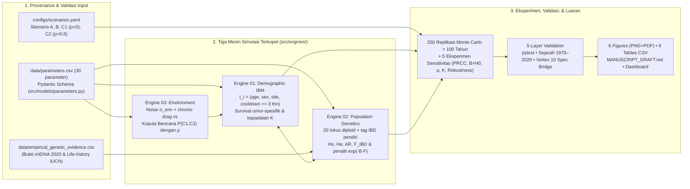
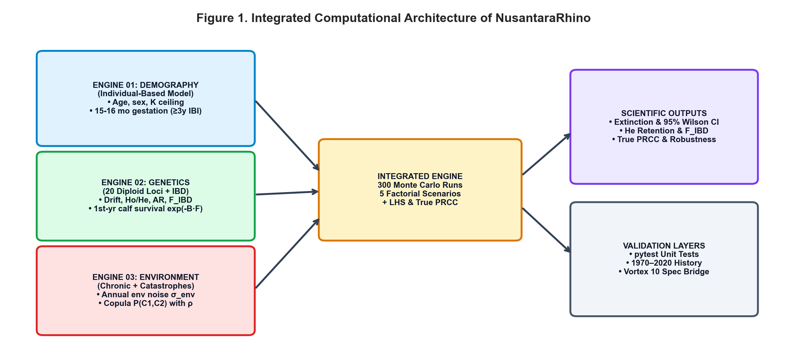
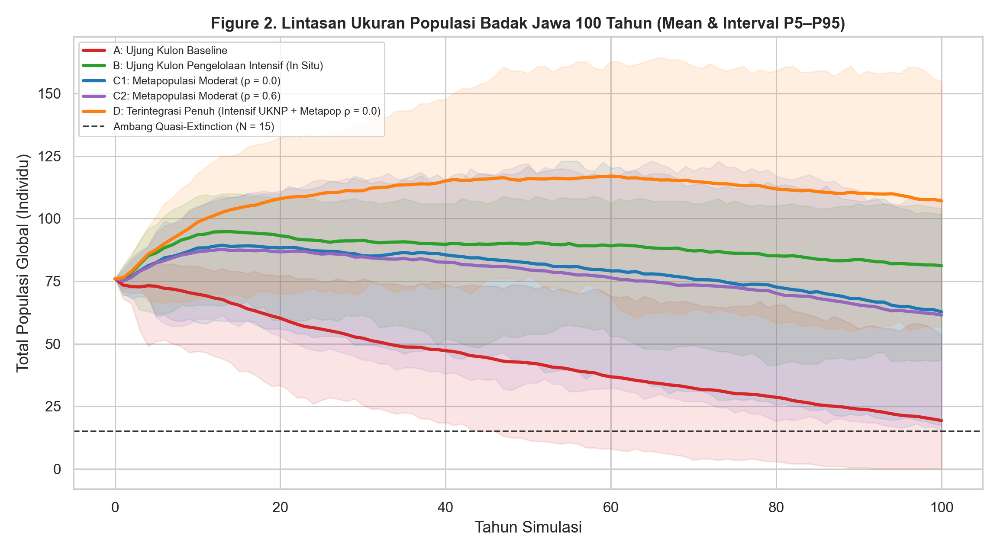
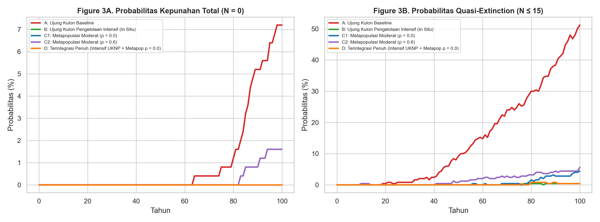
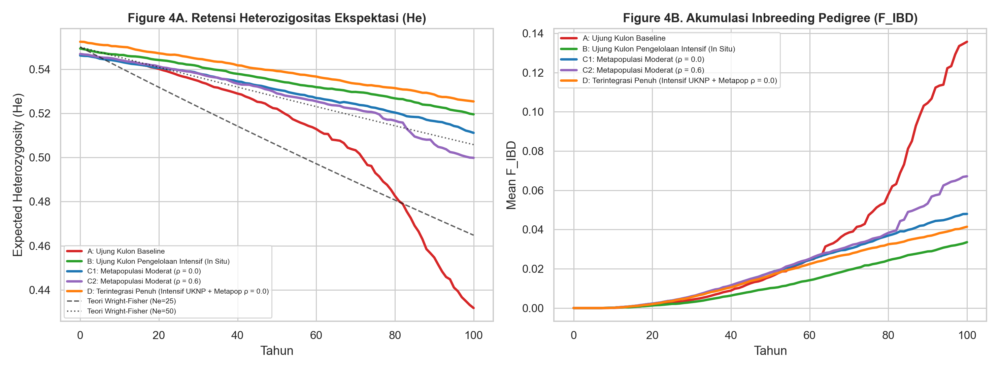
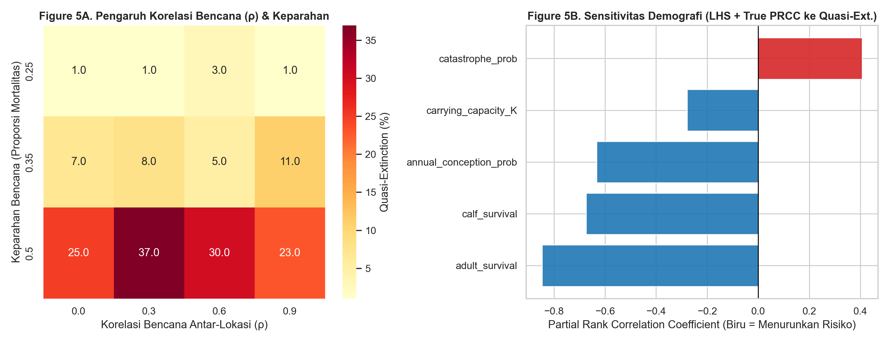
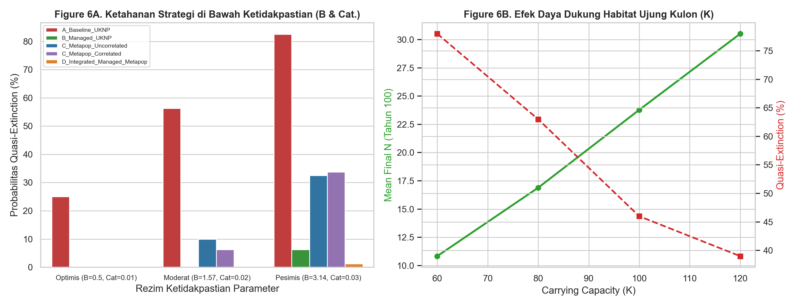

# 🦏 NusantaraRhino: Integrated Demographic, Genetic, and Environmental Stochastic Modeling for the Long-Term Conservation of the Javan Rhinoceros (*Rhinoceros sondaicus*)

> **Kandidat Publikasi Ilmiah — Research Manuscript Title:**  
> *Evaluating the Long-Term Viability of the Javan Rhinoceros under Alternative Conservation Strategies: An Integrated Stochastic Population and Genetic Modeling Approach*  
> **Bidang Riset:** Computational Conservation Biology • Individual-Based Modeling (IBM) • Population Genetics • Correlated Environmental Stochasticity • Uncertainty & Robustness Analysis

> [!IMPORTANT]
> **Prinsip Epistemik Penelitian:** Model mengikuti kualitas bukti empiris yang tersedia—bukan memaksakan data agar sesuai dengan model. Setiap parameter dipisahkan secara eksplisit sebagai `Literature-derived`, `Estimated`, `Assumed`, atau `Scenario-defined` (divalidasi via **Pydantic** di [`data/parameters.csv`](data/parameters.csv)). Model ini memperkirakan **risiko bersyarat relatif**, bukan meramalkan tahun pasti kepunahan spesies.

---

## 1. Latar Belakang, Kesenjangan Riset (*Research Gap*), & Hipotesis

Badak Jawa (*Rhinoceros sondaicus*) merupakan salah satu mamalia besar paling terancam punah di dunia, yang seluruh populasi liarnya kini terkonsentrasi hanya di satu kawasan: **Taman Nasional Ujung Kulon (TNUK / UKNP)**, Banten, Indonesia. Konsentrasi tunggal di semenanjung pesisir yang bersebelahan langsung dengan zona gunung api Krakatau dan Selat Sunda membuat spesies ini rentan terhadap tiga ancaman yang saling berinteraksi: stokastisitas demografi, erosi genetik populasi kecil, dan gangguan katastrofik serentak.

### Posisi terhadap Penelitian Sebelumnya
- **2015 Javan Rhino PHVA (CPSG / Vortex):** Telah memodelkan ancaman dan skenario populasi kedua menggunakan Vortex dari basis ~58–61 individu. Penelitian ini **tidak** mengklaim bahwa membandingkan Ujung Kulon dengan populasi kedua merupakan gagasan baru.
- **2020 Studi Kepunahan Garis Keturunan Mitokondria:** Analisis 8 spesimen museum menunjukkan populasi historis menyimpan variasi mitokondria yang lebih beragam dibanding sampel modern (*Zoological Journal of the Linnean Society*, 2020), namun gambaran lengkap keragaman genom nuklir populasi hidup saat ini belum tersedia.
- **Biologi Reproduksi (IUCN SSC Asian Rhino Specialist Group):** Masa kebuntingan Badak Jawa sekitar **15–16 bulan** dengan kelahiran tunggal dan interval antar-kelahiran multi-tahun ($\ge 3\text{–}5$ tahun)—sehingga model demografi dilarang memakai asumsi reproduksi tahunan.
- **Konteks Kebijakan (IUCN Translocation Guidelines 2025 & Kajian BRIN 2026):** Pembentukan habitat kedua (mis. evaluasi kandidat seperti Alas Purwo) masih merupakan kajian kelayakan ekologis, sosial, pengelolaan, dan konektivitas genetik—bukan keputusan pemindahan yang sudah final.

### Kebaruan Ilmiah yang Diperjuangkan
1. **Novelty 1 — Pemodelan Terintegrasi 3 Mesin:** Menggabungkan IBM demografi (dengan *cooldown* reproduksi $\ge 3$ tahun), pewarisan genetika Mendel 20-lokus + pelacakan IBD sejati, dan stokastisitas lingkungan kronis vs katastrofik.
2. **Novelty 2 — Risiko Bencana Berkorelasi Spasial ($P(C_1, C_2) \neq P(C_1)P(C_2)$):** Menguji apakah diversifikasi lokasi benar-benar menurunkan risiko kepunahan global ketika bencana antar-lokasi berkorelasi ($\rho \in [0, 0{,}9]$).
3. **Novelty 3 — Ketahanan Strategi di Bawah Ketidakpastian Parameter:** Mengidentifikasi strategi konservasi yang tetap tangguh di seluruh rentang ketidakpastian beban genetik ($B$), heterozigositas awal ($H_0$), dan daya dukung ($K$).

### Empat Hipotesis yang Diuji
- **H1 (*Single-population vulnerability*):** Populasi tunggal di UKNP memiliki risiko *quasi-extinction* dan kepunahan global tinggi terhadap gangguan kronis + bencana katastrofik.
- **H2 (*Management intervention*):** Peningkatan perlindungan, eliminasi tekanan kronis (*Arenga* / gulma), dan perluasan daya dukung $K$ memperbaiki prospek demografi secara drastis.
- **H3 (*Genetic sustainability*):** Populasi kecil dengan $N_e$ rendah mengalami pengikisan heterozigositas ($H_e$) dan akumulasi *inbreeding* ($F_{\text{IBD}}$) dari generasi ke generasi.
- **H4 (*Metapopulation resilience — bersyarat*):** Populasi kedua tidak otomatis menguntungkan di semua kondisi; ukuran pendiri (*founder*), risiko translokasi, korelasi bencana $\rho$, dan pertukaran migran genetik sangat menentukan hasilnya.

---

## 2. Desain Tiga Mesin Komputasional & Alur Validasi

---

## 3. Penjelasan Mendalam Setiap Mesin & Persamaan Matematis

1. **Engine 01 — Individual-Based Demography ([`demographic.py`](src/engines/demographic.py)):**
   Setiap individu dimodelkan eksplisit sebagai $I_i = (a_i, s_i, b_i, g_i, \text{loc}_i, c_i)$. Betina dewasa ($6 \le a_i \le 32$) hanya dapat konsepsi ketika `cooldown == 0` dan langsung memasuki masa tunggu **minimal 3 tahun** setelah melahirkan untuk mematuhi gestasi 15–16 bulan + pengasuhan anak. Kesintasan anakan usia $\le 1$ tahun dipengaruhi beban inbreeding individu: $S_{\text{calf},i} = S_{\text{calf},0} \cdot \exp(-B \cdot F_i)$.
2. **Engine 02 — Diploid Mendelian Genetics & Wright–Fisher ([`genetics.py`](src/engines/genetics.py)):**
   Melacak 20 lokus diploid tak tertaut (*state alleles* untuk $H_o$, $H_e$, $A_R$, dan *unique founder IBD tags* untuk $F_{\text{IBD}}$ sejati terhadap generasi pendiri), lalu menyandingkan penurunan $H_e$ simulasi dengan kurva teoretis $H_t = H_0 \left(1 - \frac{1}{2N_e}\right)^t$. *Guardrail epistemik:* angka ringkasan tak terverifikasi definisi metodenya (seperti `58,5%`) sengaja tidak dipakai sebagai input titik $F$; ketidakpastian dimodelkan melalui rentang $H_0 \in [0{,}35, 0{,}75]$ dan $B \in [0{,}0, 3{,}14]$.
3. **Engine 03 — Chronic vs Correlated Catastrophic Risk ([`environment.py`](src/engines/environment.py)):**
   Tekanan kronis bekerja bertahap setiap tahun pada kesintasan/daya dukung, sementara kejadian katastrofik bivariat $(C_1, C_2)$ disampling menggunakan **kopula Gaussian bivariat** dengan korelasi spasial $\rho$.
4. **Rancangan Input → Proses → Output Terperinci:** Terdokumentasi lengkap di [`reports/DATA_DICTIONARY.md`](reports/DATA_DICTIONARY.md), menghasilkan [`Table1_Parameters_and_Sources.csv`](results/tables/Table1_Parameters_and_Sources.csv) hingga [`Table6_Python_vs_Vortex.csv`](results/tables/Table6_Python_vs_Vortex.csv), spesifikasi Vortex 10 ([`results/vortex/`](results/vortex)), dan naskah manuskrip lengkap ([`MANUSCRIPT_DRAFT.md`](manuscript/MANUSCRIPT_DRAFT.md)).

---

## 4. Hasil Simulasi Nyata & Interpretasi Mendalam Seluruh Grafik (Figure 2–6)

### 4.1 Perbandingan Kelima Skenario Faktorial (Horizon 100 Tahun, 250 Replikasi/Skenario, 95% Wilson CI)

| Skenario Konservasi | Mean $N_{100}$ | Median $N_{100}$ | P5–P95 $N_{100}$ | Kepunahan Total (95% Wilson CI) | Quasi-Ext $N \le 15$ (95% Wilson CI) | Mean $H_e$ (Retensi) | Mean $F_{\text{IBD}}$ |
|---|---:|---:|---:|---:|---:|---:|---:|
| **A: Baseline UKNP** *(populasi tunggal, $K=80$, tekanan kronis)* | **19.30** | 15.0 | 0.0 – 53.5 | **7.2%** (`4.6–11.1%`) | **54.0%** (`47.8–60.1%`) | 0.4318 (**78.5%**) | **0.1357** |
| **B: Pengelolaan Intensif UKNP** *($K=105$, tanpa drag kronis, proteksi +1.5%)* | **81.20** | 87.5 | 43.5 – 104.0 | **0.0%** (`0.0–1.5%`) | **0.8%** (`0.2–2.9%`) | 0.5195 (**94.5%**) | **0.0336** |
| **C1: Metapopulasi Moderat ($\rho=0.0$)** *(14 pendiri thn ke-5, $K_1=90, K_2=70$, 2 migran/10 thn)* | **62.76** | 65.0 | 17.5 – 101.5 | **0.0%** (`0.0–1.5%`) | 6.0% (`3.7–9.7%`) | 0.5111 (**92.9%**) | 0.0479 |
| **C2: Metapopulasi Moderat ($\rho=0.6$)** *(korelasi bencana regional antar-lokasi)* | **61.46** | 60.5 | 15.0 – 108.5 | **1.6%** (`0.6–4.0%`) | 6.4% (`4.0–10.1%`) | 0.4998 (**90.9%**) | 0.0671 |
| **D: Strategi Terintegrasi Penuh** *(Intensif UKNP $K_1=105$ + Metapopulasi $K_2=70, \rho=0.0$)* | **107.10** | **109.5** | **56.5 – 155.0** | **0.0%** (`0.0–1.5%`) | **1.2%** (`0.4–3.5%`) | **0.5254 (95.5%)** | 0.0414 |

| Figure 2: Lintasan Populasi (Mean + P5–P95) | Figure 3: Kurva Kepunahan & Quasi-Extinction |
|---|---|
|  |  |

> **Interpretasi `Figure 2` & `Figure 3`:** Skenario **A (*Baseline UKNP*)** mengalami penurunan terus-menerus menuju median 15 individu dengan lebih dari separuh lintasan (`54,0%`) masuk zona *quasi-extinction* dan `7,2%` punah total (membuktikan **H1**). Sebaliknya, **Skenario B (*Pengelolaan Intensif UKNP*)** mengangkat rata-rata populasi ke `81,20` individu dengan `0,0%` kepunahan total dan hanya `0,8%` *quasi-extinction* (membuktikan **H2**). Pada **Skenario C1 vs C2**, diversifikasi lokasi tanpa korelasi bencana ($\rho=0$) menekan kepunahan total ke `0,0%`, tetapi ketika korelasi bencana regional dinaikkan ke $\rho = 0{,}6$ (**C2**), kurva kepunahan total muncul kembali (`1,6%`). Terakhir, desain faktorial **Skenario D (*Strategi Terintegrasi Penuh*)** membuktikan bahwa menggabungkan proteksi intensif *in situ* UKNP dengan populasi kedua berisiko bencana independen menembus batas daya dukung lokasi tunggal dan mencapai rata-rata **`107,10` individu** (`95,5%` retensi $H_e$, `0,0%` kepunahan).

---

### 4.2 Dinamika Genetika Populasi ($H_e$ & $F_{\text{IBD}}$)

> **Interpretasi `Figure 4`:** Pada Skenario A, penyusutan populasi mempercepat *genetic drift* sehingga $H_e$ turun lebih cepat dari garis teoretis Wright–Fisher $N_e=50$ (mendekati kurva $N_e=25$, tersisa `78,5%` $H_0$) dan inbreeding pedigree melonjak ke **$F_{\text{IBD}} = 0{,}1357$**—membuktikan **H3**. Skenario D (`95,5%` $H_e$ bertahan, $A_R = 3{,}916$), B (`94,5%` $H_e$, $F_{\text{IBD}} = 0{,}0336$), dan C1 (`92,9%` $H_e$, $F_{\text{IBD}} = 0{,}0479$) menahan erosi genetik secara efektif.

---

### 4.3 Hasil 5 Eksperimen Sensitivitas (Latin Hypercube + True PRCC), Validasi Historis, & Jembatan Vortex 10

| Figure 5: Korelasi Bencana (ρ) & Sensitivitas True PRCC | Figure 6: Ketahanan Strategi & Daya Dukung Habitat (K) |
|---|---|
|  |  |

1. **Eksperimen 1 — Demographic Latin Hypercube Sampling ($N=36$) & True Partial Rank Correlation Coefficient (`Figure 5B` & `Table 5`):**
   Setelah mengontrol varians parameter lain melalui regresi residual peringkat (**True PRCC**), terungkap kontribusi parsial keempat parameter demografi yang sebelumnya tertutup oleh korelasi Spearman bivariat:
   - **`adult_survival`:** **`PRCC = -0.8465`** ($p < 0{,}0001$) terhadap *quasi-extinction* (`PRCC = +0.9278` terhadap $N_{100}$) — pengungkit demografi paling dominan.
   - **`calf_survival`:** **`PRCC = -0.6740`** ($p < 0{,}0001$) terhadap *quasi-extinction* (`PRCC = +0.8392` terhadap $N_{100}$).
   - **`annual_conception_prob`:** **`PRCC = -0.6326`** ($p = 0{,}0001$) terhadap *quasi-extinction* (`PRCC = +0.7359` terhadap $N_{100}$).
   - **`catastrophe_prob`:** **`PRCC = +0.4070`** ($p = 0{,}0208$) terhadap *quasi-extinction* (`PRCC = -0.6793, p < 0{,}0001$ terhadap $N_{100}$).
2. **Eksperimen 2 — Genetic Load ($B \times H_0$):** Kenaikan *lethal equivalents* $B$ dari `0.0 → 1.57 → 3.14` (pada $H_0 = 0{,}55$) meningkatkan *quasi-extinction* Skenario A dari **`28,75%` → `56,25%` → `72,50%`**.
3. **Eksperimen 3 — Spatially Correlated Catastrophes (`Figure 5A`):** Saat $\rho$ naik dari `0.0 → 0.9` (keparahan `0.35`), rata-rata bencana ganda serentak di kedua lokasi meningkat dari **`0,09` menjadi `1,40` kejadian/abad**.
4. **Eksperimen 4 — Carrying Capacity $K$ (`Figure 6B`):** Peningkatan $K$ di UKNP dari `60 → 120` menurunkan *quasi-extinction* (`78,0% → 39,0%`) dan menekan $F_{\text{IBD}}$ hampir **4× lipat** (`0,2957` → `0,0785`).
5. **Eksperimen 5 — Robustness 5 Strategi Faktorial di Bawah Ketidakpastian (`Figure 6A`):** Di bawah skenario paling pesimis ($B = 3{,}14$, bencana 3%/thn):
   - Memindahkan 14 pendiri ketika populasi sumber hanya dikelola secara moderat (**C1/C2**: `32,5–33,75%` *quasi-extinction*, `2,5–5,0%` punah total) lebih berisiko dibanding memfokuskan pengelolaan intensif di UKNP (**Skenario B**: `6,25%` *quasi-extinction*, `1,25%` punah total).
   - Namun ketika pengelolaan intensif UKNP dipadukan dengan metapopulasi bebas korelasi bencana (**Skenario D**), risiko kepunahan total tetap **`0,0%`** dan *quasi-extinction* turun 5× lipat menjadi **`1,25%`** (rata-rata $N_{100} = 72{,}53$), membuktikan **H4 bersyarat secara faktorial**!
6. **Validasi 5-Lapis & Vortex 10 Bridge (`Table 6`):**
   - Uji lintasan historis 50 tahun ($N_0=30 \rightarrow \bar{N}_{50} = 49{,}0$, IQR `36,2–65,0`) konsisten dengan pertumbuhan historis Ujung Kulon 1970–2020.
   - Spesifikasi setara **Vortex 10** diekspor ke [`results/vortex/`](results/vortex) (`vortex_scenario_spec.csv` & `vortex_project_template.xml`) bersama jangkar 2015 PHVA ($N_0=60 \rightarrow \bar{N}_{100} = 20{,}51$, kepunahan `11,33%`); kolom eksternal Vortex ditandai jujur sebagai *Pending External Run* karena perangkat lunak Vortex 10 tidak terpasang secara lokal.

---

## 5. Kesimpulan Konservasi, Keterbatasan, & Naskah Lengkap

- **Rekomendasi Strategi Bertahap:** Prioritas mutlak pertama adalah **penguatan penuh Ujung Kulon** (menekan kematian dewasa mendekati nol dan memperluas $K \ge 100$ lewat pengendalian *Arenga*); pembentukan populasi kedua harus dilakukan **secara bersyarat** setelah populasi sumber stabil, memilih lokasi dengan korelasi bencana serendah mungkin ($\rho \approx 0$), serta menjamin pertukaran genetik berkala.
- **Naskah Lengkap (Struktur IMRaD 10 Bagian):** [`manuscript/MANUSCRIPT_DRAFT.md`](manuscript/MANUSCRIPT_DRAFT.md)
- **Kamus Data & Protokol Riset:** [`docs/RESEARCH_PROTOCOL_v1.0.md`](docs/RESEARCH_PROTOCOL_v1.0.md) • [`reports/DATA_DICTIONARY.md`](reports/DATA_DICTIONARY.md)
