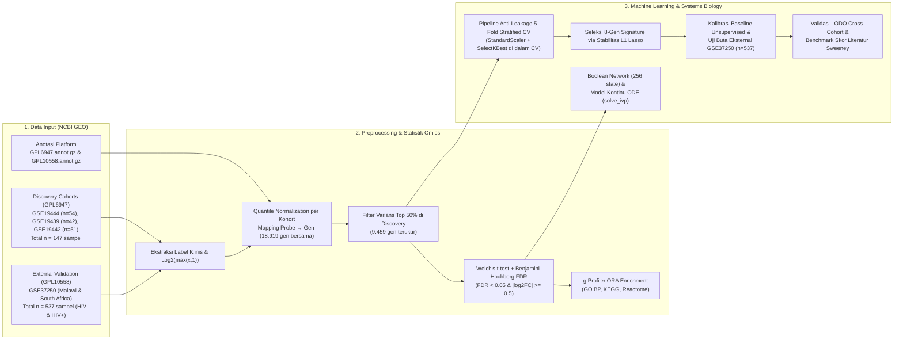
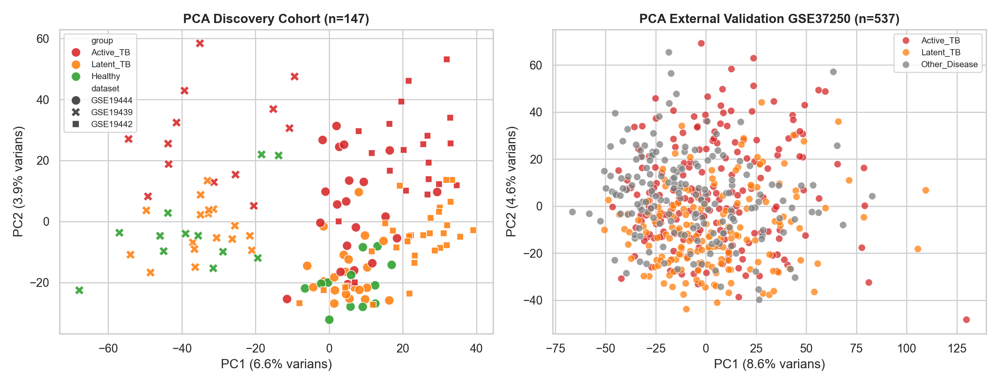
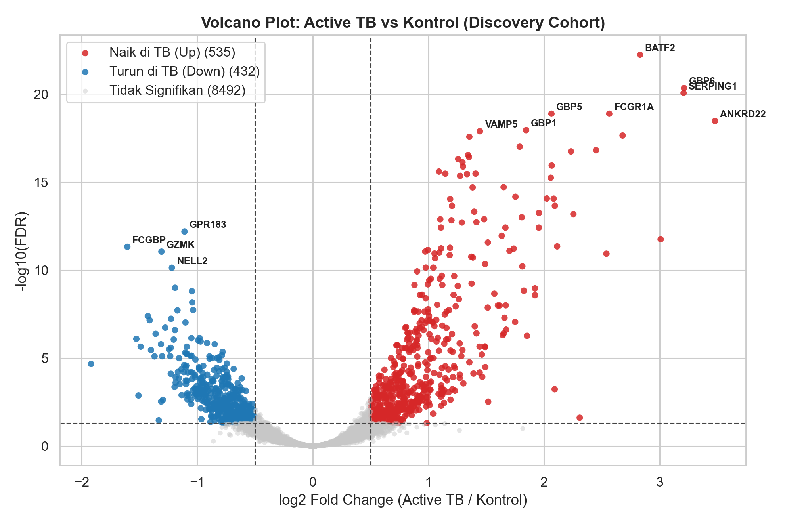
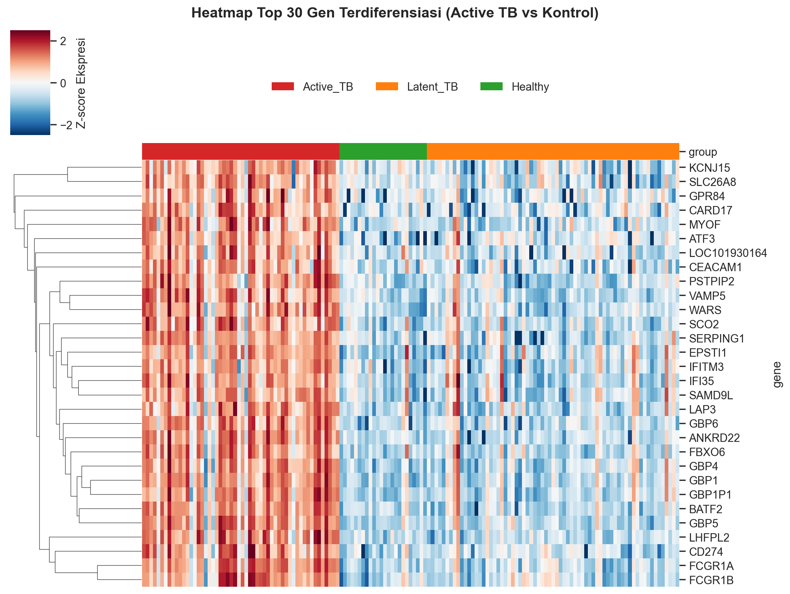
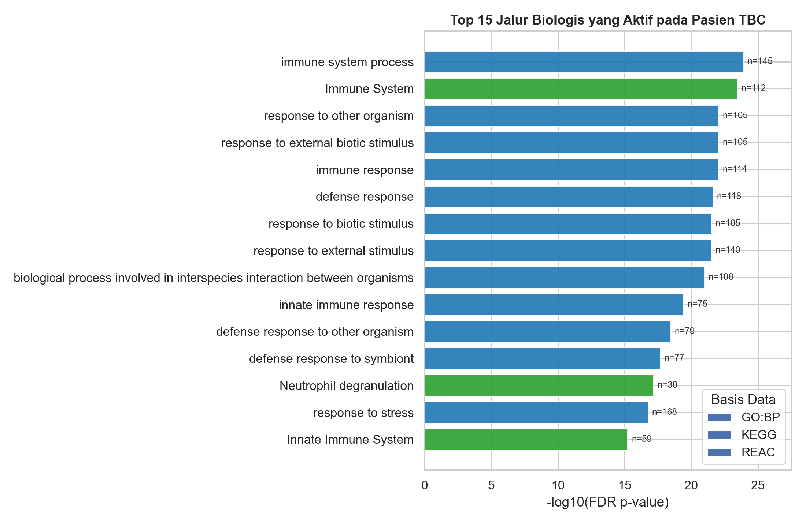
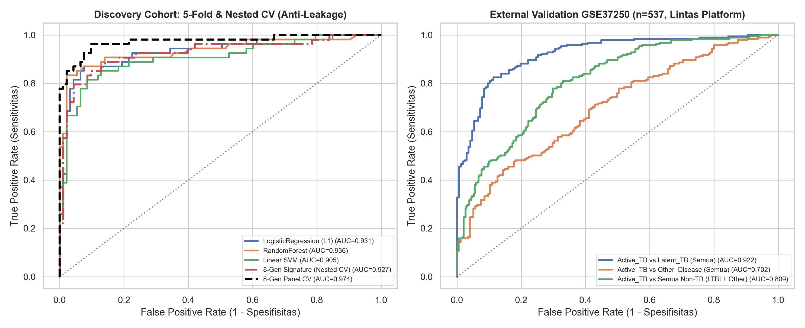
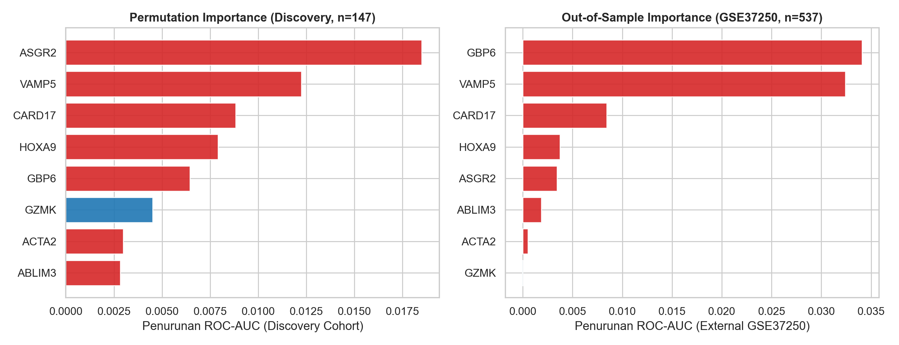
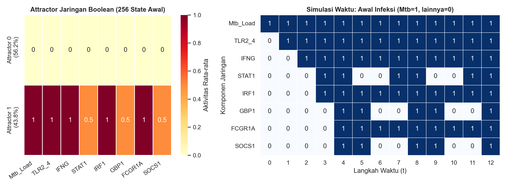
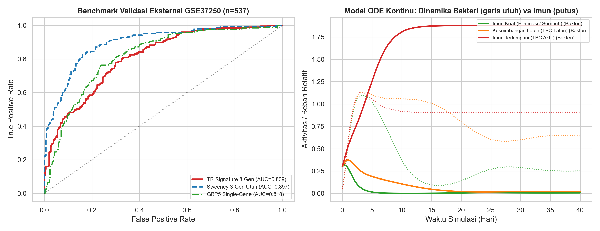

# 🫁 TB-Signature: Host Blood Transcriptomic Biomarker Discovery, Cross-Platform Machine Learning, & Systems Biology Modeling for Tuberculosis

> **Bidang Riset:** Translational & Clinical Bioinformatics • Microarray Transcriptomics • Explainable Machine Learning • Systems Biology (Boolean Network & Continuous ODE)  
> **Kohort Data:** `GSE19444`, `GSE19439`, `GSE19442` (*Discovery*, $n=147$, Illumina HumanHT-12 V3 `GPL6947`) → `GSE37250` (*Independent External Validation*, $n=537$, Illumina HumanHT-12 V4 `GPL10558`)

---

## 1. Latar Belakang & Urgensi Klinis

Tuberkulosis (TBC), yang disebabkan oleh bakteri intraseluler *Mycobacterium tuberculosis*, tetap menjadi salah satu penyebab kematian infeksius tertinggi secara global, dengan Indonesia menempati posisi negara berbeban kasus tertinggi kedua di dunia. Dalam praktik klinis, tantangan diagnostik paling krusial bukan sekadar mendeteksi keberadaan bakteri di dahak, melainkan **membedakan tiga kondisi klinis yang gejalanya sering tumpang tindih**:
1. **TBC Aktif (*Active TB*):** bakteri bereplikasi aktif, menular, dan membutuhkan terapi antibiotik kombinasi intensif segera.
2. **TBC Laten (*Latent TB Infection / LTBI*):** bakteri dorman tanpa gejala klinis dan tidak menular, namun menyimpan risiko reaktivasi.
3. **Penyakit Infeksi/Inflamasi Lain (*Other Diseases*):** pneumonia bakterial, infeksi virus, atau keganasan yang memicu respons peradangan serupa.

Uji dahak (*sputum smear/culture*) sering gagal pada pasien anak, pasien koinfeksi HIV, atau kasus TBC ekstra-paru. Oleh karena itu, **transkriptomik darah tepi (*whole-blood transcriptomics*)** menawarkan pendekatan non-invasif: sel darah putih yang bersirkulasi membawa rekaman sinyal molekuler sistem imun terhadap infeksi *M. tuberculosis*.

### Pertanyaan Riset
1. Gen dan jalur biologis inang mana saja di dalam darah tepi yang mengalami perubahan aktivitas paling konsisten antara pasien **TBC Aktif** dan kelompok **Non-TBC** (*Latent TB* + *Healthy*)?
2. Dapatkah panel ekspresi gen ringkas (*compact gene signature*) membedakan TBC Aktif secara akurat **lintas kohort geografi** (London vs Afrika Selatan) maupun **lintas platform chip microarray** tanpa kebocoran data (*data leakage*)?
3. Bagaimana interaksi regulasi umpan balik antar-komponen utama jalur Interferon ketika dimodelkan secara mekanistik melalui **Boolean Network** dan **Sistem Persamaan Diferensial Biasa (ODE)**?

---

## 2. Arsitektur Komputasional & Alur Data (*End-to-End Pipeline*)

Pipeline dibangun secara modular dari akuisisi data mentah hingga validasi eksternal lintas benua dan pemodelan biologi sistem:

---

## 3. Penjelasan Konsep, Metodologi, & Rancangan Input–Proses–Output

### 3.1 Mengapa Preprocessing & Normalisasi Dilakukan Seperti Ini?
- **Transformasi `log2`:** Nilai intensitas mentah *microarray* Illumina di GEO masih berskala linear (ratusan hingga puluhan ribu) dengan distribusi miring ke kanan. Mengambil $\log_2$ mengubah rasio ekspresi multiplikatif menjadi selisih aditif yang simetris ($\log_2 FC = +1 \equiv 2\times$ kenaikan; $+3 \equiv 8\times$ kenaikan; $-1 \equiv 0{,}5\times$ penurunan).
- ***Quantile Normalization*:** Variasi teknis seperti perbedaan intensitas pewarnaan atau pemindaian antar-chip disamakan dengan memetakan distribusi intensitas setiap sampel ke distribusi peringkat rata-rata kohortnya, menjaga urutan ekspresi gen internal masing-masing pasien tetap utuh.
- **Pemetaan Probe → Simbol Gen:** Satu gen sering diwakili beberapa *probe* Illumina. Dengan mengambil *probe* berintensitas rata-rata tertinggi dan menyelaraskan hanya gen yang muncul di **kedua platform** (`GPL6947` dan `GPL10558`), diperoleh **18.919 gen bersama**, lalu disaring 50% gen bervarians tertinggi di Discovery (**9.459 gen**) secara *unsupervised* (tanpa melihat label kelas).

### 3.2 Mengapa Wajib Koreksi Berganda FDR (*Benjamini–Hochberg*)?
Menguji $9.459$ gen secara simultan dengan ambang naive $p < 0{,}05$ secara statistik akan memunculkan $\approx 473$ hasil positif palsu murni karena kebetulan. Oleh karena itu, skrip [`03_differential_expression.py`](src/03_differential_expression.py) menggunakan **Welch's *t*-test** (yang tidak mengasumsikan kesamaan varians antar-kelompok sakit dan sehat) diikuti koreksi **Benjamini–Hochberg (FDR)** serta syarat efek biologis $|\log_2 FC| \ge 0{,}5$.

### 3.3 Mengapa Pipeline Anti-*Data Leakage* & Kalibrasi Lintas Platform Sangat Penting?
Kesalahan klasik pada studi *biomarker* adalah melakukan seleksi fitur pada seluruh dataset sebelum pemisahan *Cross-Validation*—yang membocorkan informasi label data uji ke pemilihan gen dan menghasilkan akurasi semu. Di [`05_machine_learning.py`](src/05_machine_learning.py):
1. Seluruh transformasi (`StandardScaler` dan `SelectKBest`) dibungkus **di dalam `sklearn.pipeline.Pipeline`**, sehingga seleksi fitur dihitung ulang murni dari *training fold* di tiap putaran *5-Fold Stratified CV*.
2. Setiap pasien terlebih dahulu dinormalisasi secara internal (*per-sample z-score* across $9.459$ gen), kemudian baseline per gen dikalibrasi secara ***unsupervised*** di dalam kohort platform target (`GPL10558`) tanpa menyentuh label klinis sedikit pun, untuk mengatasi pergeseran afinitas *probe* antara Illumina HT-12 V3 dan V4.

### 3.4 Dokumentasi Lengkap Input → Proses → Output

| Tahap | Modul | Input | Proses Utama | Output (`results/`) |
|---|---|---|---|---|
| **1** | `src/01_download_data.py` | FTP NCBI GEO (`GSE19444`, `GSE19439`, `GSE19442`, `GSE37250`, `GPL6947`, `GPL10558`) | Unduh atomik ke cache lokal + inspeksi metadata karakteristik sampel | `data/raw/*.txt.gz`, `*.annot.gz` |
| **2** | `src/02_preprocess.py` | Series matrix & anotasi platform | Parsing label `Sample_source_name_ch1`, `log2`, *quantile norm*, mapping gen, filter varians 50%, PCA | `data/processed/*.parquet`, `02_sample_summary.csv`, `02_pca_discovery.csv`, `02_qc_pca.png` |
| **3** | `src/03_differential_expression.py` | `discovery_expr.parquet`, `discovery_meta.csv` | Welch *t*-test, Benjamini–Hochberg FDR, $\log_2 FC$, *hierarchical clustering* | `03_differential_expression.csv`, `03_top30_degs.csv`, `03_volcano_plot.png`, `03_heatmap_top30.png` |
| **4** | `src/04_enrichment.py` | 535 gen Up + 9.459 gen *background* | Over-Representation Analysis ke API g:Profiler (`GO:BP`, `KEGG`, `REAC`) | `04_pathway_enrichment.csv`, `04_pathway_enrichment.png` |
| **5** | `src/05_machine_learning.py` | Discovery ($n=147$) & `GSE37250` ($n=537$) | 5-Fold CV (RF, LogReg L1, Linear SVM), seleksi **8-Gen Signature**, *Permutation Importance*, validasi eksternal & subgrup HIV | `05_cv_comparison.csv`, `05_signature_genes.csv`, `05_external_validation.csv`, `05_roc_curves.png`, `05_signature_importance.png` |
| **6** | `src/06_boolean_network.py` | Jaringan regulasi imun 8-node | Simulasi sinkron seluruh $2^8 = 256$ kondisi awal, pemetaan *basin of attraction* | `06_boolean_attractors.csv`, `06_boolean_trajectory_infection.csv`, `06_boolean_network.png` |
| **7** | `src/07_lodo_benchmark_ode.py` | 3 kohort Discovery, `GSE37250`, model terlatih | Validasi *Leave-One-Dataset-Out* (LODO), *benchmark* vs skor literatur *Sweeney*, simulasi kontinu 4-ODE (`solve_ivp`) | `07_lodo_validation.csv`, `07_benchmark_sweeney3.csv`, `07_ode_simulation.csv`, `07_benchmark_and_ode.png` |

---

## 4. Hasil Analisis & Interpretasi Mendalam Setiap Visualisasi

### 4.1 Komposisi Kohort & Kontrol Kualitas (`PCA`)
- **Discovery (`n = 147`, `GPL6947`):** `GSE19439` (13 Active TB, 17 Latent TB, 12 Healthy), `GSE19442` (20 Active TB, 31 Latent TB), `GSE19444` (21 Active TB, 21 Latent TB, 12 Healthy) → total **54 Active TB** vs **93 Non-TB**.
- **External Validation (`n = 537`, `GPL10558`):** `GSE37250` dari Malawi & Afrika Selatan (**195 Active TB**, **167 Latent TB**, **175 Other Diseases**; terdiri dari **263 HIV-** dan **274 HIV+**).

> **Interpretasi Gambar (`02_qc_pca.png`):** Pada kohort Discovery (kiri), komponen utama pertama (`PC1`) memisahkan mayoritas pasien *Active TB* (merah) dari kelompok *Latent TB* (oranye) dan *Healthy* (hijau) secara konsisten lintas studi London maupun Afrika Selatan. Pada kohort validasi eksternal `GSE37250` (kanan), pemisahan *Active TB* vs *Latent TB* tetap terlihat jelas, sementara kelompok *Other Disease* (abu-abu) tersebar tumpang tindih di tengah—memberi sinyal awal bahwa penyakit inflamasi/infeksi lain berbagi sebagian profil transkriptomik darah dengan TBC aktif.

---

### 4.2 Ekspresi Diferensial (*Differential Gene Expression*) & Jalur Biologis
Sebanyak **967 gen** berubah signifikan (`FDR < 0.05`, `|log2FC| >= 0.5`): **535 gen meningkat (*Up*)** dan **432 gen menurun (*Down*)** pada pasien TBC Aktif. Sepuluh gen paling signifikan antara lain:
- **`BATF2`** ($\log_2 FC = +2{,}83$, $\text{FDR} = 5{,}69 \times 10^{-23}$)
- **`GBP6`** ($+3{,}21$, $4{,}47 \times 10^{-21}$) & **`GBP5`** ($+2{,}06$) & **`GBP1`** ($+1{,}85$) — keluarga *Guanylate Binding Proteins* efektor intraseluler penginduksi pembunuhan bakteri di makrofag
- **`SERPING1`** ($+3{,}21$), **`FCGR1A`** ($+2{,}56$), **`ANKRD22`** ($+3{,}48$), **`VAMP5`** ($+1{,}45$), **`CARD17`** ($+2{,}68$), dan **`PSTPIP2`** ($+1{,}35$)

| Volcano Plot | Clustered Heatmap Top 30 DEGs |
|---|---|
|  |  |

> **Interpretasi Gambar (`03_volcano_plot.png` & `03_heatmap_top30.png`):** *Volcano plot* memperlihatkan asimetri aktivasi imun yang kuat ke arah kanan atas (*upregulated*): gen-gen yang dirangsang sinyal Interferon (`BATF2`, `GBP6`, `SERPING1`, `FCGR1A`, `ANKRD22`) melonjak hingga $6\times$–$11\times$ lipat. Pada *heatmap* 30 gen teratas (kanan), hampir seluruh pasien *Active TB* (bar merah) membentuk blok aktivasi merah terang yang seragam, kontras dengan kelompok *Latent TB* dan *Healthy* yang tetap tenang (biru).

> **Interpretasi Gambar (`04_pathway_enrichment.png`):** Pengayaan jalur biologis pada 535 gen yang naik (terhadap latar belakang 9.459 gen terukur) menghasilkan **497 jalur signifikan (`FDR < 0.05`)**, didominasi oleh *immune system process* (`n = 145`, $p = 1{,}16 \times 10^{-24}$), Reactome *Immune System* (`n = 112`, $p = 3{,}45 \times 10^{-24}$), *defense response* (`n = 118`), dan *innate immune response* (`n = 75`). Ini menegaskan secara biologis bahwa penanda darah TBC aktif digerakkan oleh kaskade imun bawaan dan pensinyalan interferon.

---

### 4.3 Performa Machine Learning, Nested CV Anti-Leakage, 8-Gen Signature, & Validasi Eksternal (`GSE37250`)

Pada *5-Fold Stratified Cross-Validation* & *Nested 5×4-Fold CV* (Discovery, $n=147$, seleksi fitur murni di dalam *training fold*):

| Model Klasifikasi | CV ROC-AUC | CV Akurasi | CV F1-Score |
|---|---:|---:|---:|
| **Random Forest** *(SelectKBest di dalam Pipeline)* | **0.9358** | **91.16%** | **0.8738** |
| **Logistic Regression (L1)** *(SelectKBest di dalam Pipeline)* | **0.9309** | 90.48% | 0.8679 |
| **8-Gen Signature (Nested 5×4-Fold CV — Strictly Leak-Free)** | **0.9265** | 87.76% | 0.8302 |
| **Linear SVM** *(SelectKBest di dalam Pipeline)* | 0.9054 | 87.76% | 0.8235 |

Dari stabilitas koefisien penalti L1 across lipatan CV, disaring panel diagnostik ringkas **8-Gen Signature**: **`ASGR2`**, **`VAMP5`**, **`CARD17`**, **`HOXA9`**, **`GBP6`**, **`GZMK`** ($\log_2 FC = -1{,}31$, turun pada TBC aktif), **`ACTA2`**, dan **`ABLIM3`**.

Ketika model 8-gen ini diuji langsung tanpa pelatihan ulang ke **537 sampel eksternal `GSE37250`** (Malawi & Afrika Selatan, platform `GPL10558`) menggunakan dua mode kalibrasi (**Mode Kohort Unsupervised** vs **Mode Single-Sample Frozen-Discovery** yang memprediksi 1 pasien secara mandiri tanpa menyentuh sampel lain di kohort uji):

| Tugas Evaluasi Eksternal (`GSE37250`) | N Sampel | Active TB | ROC-AUC (Cohort-Cal) | ROC-AUC (True Single-Sample) | Akurasi | Sensitivitas | Spesifisitas |
|---|---:|---:|---:|---:|---:|---:|---:|
| **Active TB vs Latent TB** | 362 | 195 | **0.9221** | **0.9101** | 80.39% | 69.74% | **92.81%** |
| **Active TB vs Semua Non-TB (LTBI + Other)** | 537 | 195 | **0.8092** | **0.7790** | 73.18% | 69.74% | 75.15% |
| **Subgrup HIV- (Active TB vs Non-TB)** | 263 | 97 | **0.8290** | **0.8024** | 75.29% | 69.07% | 78.92% |
| **Subgrup HIV+ (Active TB vs Non-TB)** | 274 | 98 | **0.7915** | **0.7538** | 71.17% | 70.41% | 71.59% |
| **Active TB vs Other Disease** | 370 | 195 | **0.7015** | **0.6540** | 64.32% | 69.74% | 58.29% |

| Kurva ROC Internal & Eksternal | Kontribusi Gen Signature (Discovery vs Out-of-Sample GSE37250) |
|---|---|
|  |  |

> **Interpretasi Gambar (`05_roc_curves.png` & `05_signature_importance.png`):** Model 8-gen sangat kokoh membedakan TBC Aktif dari TBC Laten (`AUC = 0.922` pada kalibrasi kohort; `AUC = 0.910` pada prediksi *single-sample* murni) baik pada pasien HIV- (`AUC = 0.829`) maupun HIV+ (`AUC = 0.792`). Evaluasi *Out-of-Sample Permutation Importance* di `GSE37250` (`05_signature_importance.png` kanan) mengonfirmasi bahwa **`GBP6`** (`+0.0341`), **`VAMP5`** (`+0.0324`), dan **`CARD17`** (`+0.0084`) merupakan pendorong generalisasi lintas-platform terkuat.

---

### 4.4 Validasi Lintas Kohort (*Strict LODO*), *Benchmark* Literatur *Sweeney 3-Gene* Utuh, & Pemodelan Biologi Sistem

1. **Leave-One-Dataset-Out (LODO) Validation (Strict Leak-Free vs Fixed-8 Consensus):**
   - Uji pada `GSE19439` (London): **Strict LODO `ROC-AUC = 0.8727`** (`PR-AUC = 0.8690`) | Fixed-8 `ROC-AUC = 0.9947`
   - Uji pada `GSE19442` (**Afrika Selatan — pemilihan 8 gen & pelatihan dilakukan murni di kohort London**): **Strict LODO `ROC-AUC = 0.9565`** (`PR-AUC = 0.9525`) | Fixed-8 `ROC-AUC = 0.9871`
   - Uji pada `GSE19444` (London): **Strict LODO `ROC-AUC = 0.9019`** (`PR-AUC = 0.8912`) | Fixed-8 `ROC-AUC = 0.9596`
2. **Benchmark terhadap Skor Literatur *Sweeney 3-Gene* Utuh (`0.5*(GBP5 + DUSP3) - KLF2`) & `GBP5` Tunggal di `GSE37250`:**
   - Pada *Active TB vs Latent TB*, **8-Gen Signature (`AUC = 0.9221`, `PR-AUC = 0.9348`)** setara dengan skor meta-analisis 14-kohort *Sweeney 3-Gene* utuh (`AUC = 0.9260`, `PR-AUC = 0.9416`) dan mengungguli jauh `GBP5` tunggal (`AUC = 0.8363`).
   - Pada *Active TB vs Other Disease*, *Sweeney 3-Gene* utuh (`AUC = 0.8703`) dan `GBP5` tunggal (`AUC = 0.8001`) lebih unggul dibanding 8-Gen Signature (`0.7015`), karena kohort Discovery proyek ini (`GSE19491`) hanya memuat kontrol *Healthy* dan *Latent TB*, sedangkan studi Sweeney et al. (2016) dilatih pada 14 kohort yang secara eksplisit menyertakan kelompok *Other Diseases* untuk menekan positif palsu inflamasi non-TBC.
3. **Boolean Network & Sistem ODE Kontinu:**
   - Dari $2^8 = 256$ ruang keadaan jaringan 8-node (`Mtb_Load`, `TLR2_4`, `IFNG`, `STAT1`, `IRF1`, `GBP1`, `FCGR1A`, `SOCS1`), ditemukan tepat **2 attractor**: (1) **Fixed Point Sehat** (`56,2%` *basin of attraction*) dan (2) **Limit Cycle periode 4** (`43,8%` *basin*) yang memodelkan osilasi akibat umpan balik negatif `SOCS1` menekan `STAT1`.
   - Simulasi ODE 4-variabel (`solve_ivp`, 40 hari) memvisualisasikan transisi antara eliminasi bakteri, keseimbangan laten, dan infeksi aktif kronis.

| Boolean Network Imun TBC | Benchmark Eksternal & Dinamika ODE Kontinu |
|---|---|
|  |  |

---

## 5. Kesimpulan, Keterbatasan Ilmiah, & Referensi

### Kesimpulan Utama
1. Respons transkriptomik darah tepi pada TBC Aktif didominasi oleh aktivasi jalur **Interferon dan imunitas bawaan** (`BATF2`, keluarga `GBP`, `FCGR1A`, `SERPING1`), yang konsisten lintas benua (London → Afrika Selatan → Malawi).
2. Panel ringkas **8 gen** mempertahankan performa diskriminasi tinggi terhadap TBC Laten (`AUC = 0.922`) dan tetap stabil pada kelompok koinfeksi HIV+ (`AUC = 0.792`).
3. Kombinasi pendekatan *data-driven* (ML) dan *mechanistic modeling* (Boolean + ODE) menjelaskan dinamika regulasi dan batas spesifisitas biologis respons interferon.

### Keterbatasan & Catatan Ilmiah
- **Spesifisitas terhadap *Other Diseases* (`AUC = 0.702`):** Infeksi saluran napas dan inflamasi non-TBC lain berbagi sebagian jalur imun bawaan; diperlukan penambahan fitur penekan positif palsu atau integrasi klinis sebelum aplikasi diagnostik.
- **Kebutuhan Validasi Wet-Lab:** Biomarker *in silico* ini memerlukan verifikasi pada platform RT-qPCR serta kalibrasi populasi Indonesia sebelum dipertimbangkan untuk riset translasi klinis. Bukan alat diagnosis medis.
- **Model Boolean & ODE:** Bersifat kualitatif/konseptual berbasis literatur imunologi untuk mengeksplorasi struktur *attractor*, bukan model farmakokinetik pasien individual.

### Referensi Data & Pustaka
1. Berry, M. P. R., et al. (2010). *An interferon-inducible neutrophil-driven blood transcriptional signature in human tuberculosis*. **Nature**, 466, 973–977. (`GSE19491`: `GSE19444`, `GSE19439`, `GSE19442`).
2. Kaforou, M., et al. (2013). *Detection of tuberculosis in HIV-infected and -uninfected African adults using whole blood RNA expression signatures: a case-control study*. **PLoS Medicine**, 10(10), e1001538. (`GSE37250`).
3. Sweeney, T. E., et al. (2016). *Genome-wide expression for diagnosis of pulmonary tuberculosis: a multicohort analysis*. **The Lancet Respiratory Medicine**, 4(3), 213–224.
