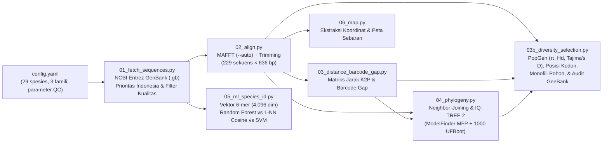
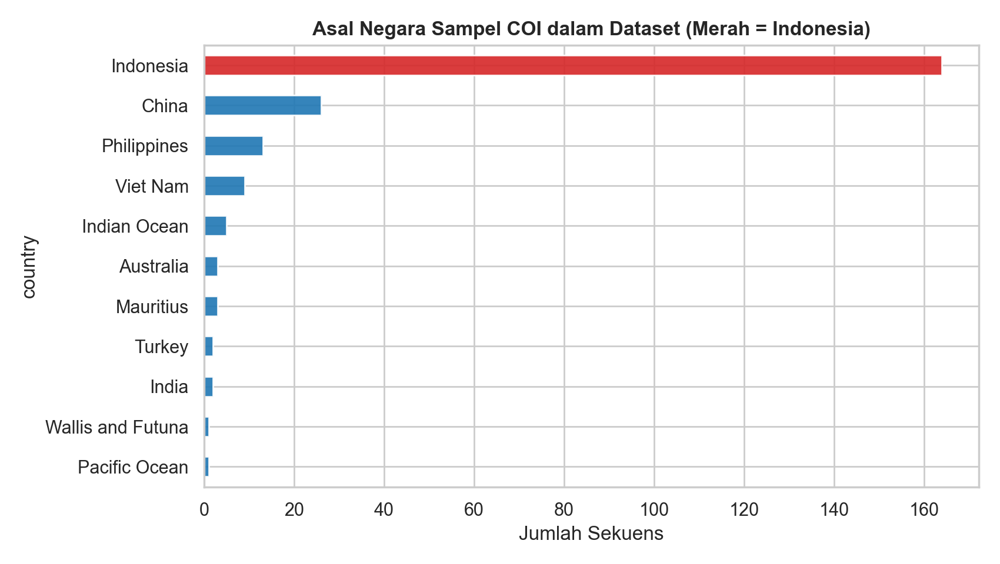
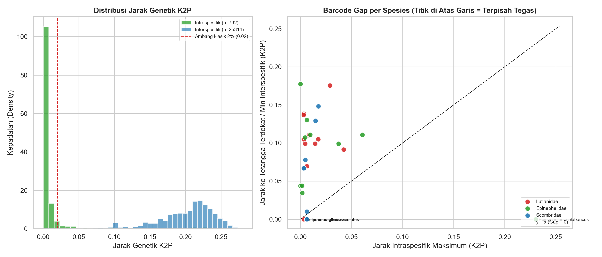
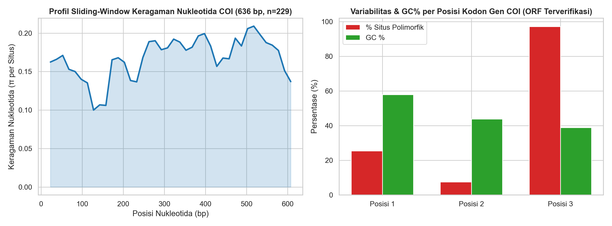
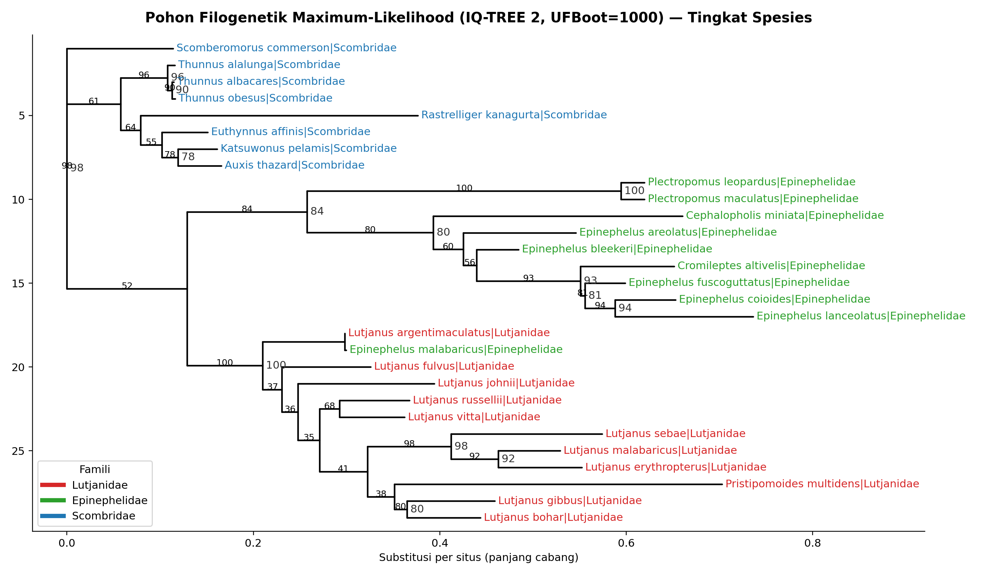
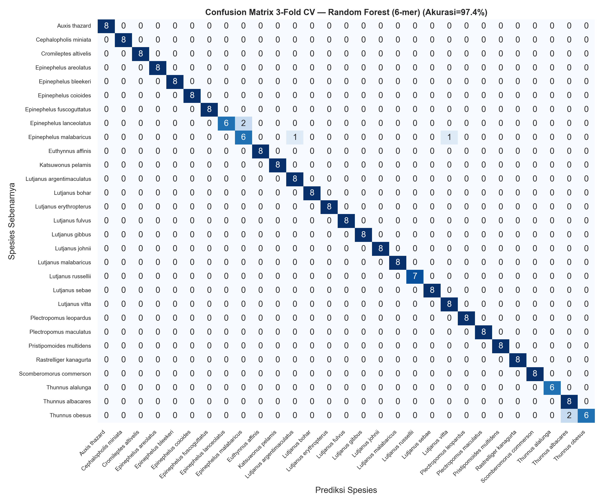

# 🐟 NusantaraBarcode: Automated COI DNA Barcoding, Phylogenetics, Population Genetics, & GenBank Audit for Indonesian Commercial Fishes

> **Bidang Riset:** Molecular Bioinformatics • DNA Barcoding • Molecular Evolution & Phylogenetics • Population Genetics • Automated Bio-HPC Workflows (`Snakemake`) • Alignment-Free Machine Learning  
> **Cakupan Taksonomi:** **29 Spesies Ikan Konsumsi Utama Indonesia** (Segitiga Terumbu Karang / *Coral Triangle*) — Famili *Lutjanidae* (Kakap), *Epinephelidae* (Kerapu), & *Scombridae* (Tuna/Tongkol)

---

## 1. Latar Belakang & Urgensi Riset

Indonesia berada di pusat **Segitiga Terumbu Karang (*Coral Triangle*)** dengan keanekaragaman iktiofauna tertinggi di dunia. Namun, komoditas perikanan bernilai ekonomi tinggi seperti **kakap merah (*Lutjanus*)**, **kerapu sunu/macan (*Epinephelus/Plectropomus*)**, dan **tuna (*Thunnus*)** menghadapi dua ancaman serius:
1. **Pemalsuan Label Pangan Laut (*Seafood Fraud*):** Ketika ikan sudah diproses menjadi fillet tanpa kepala dan sirip, spesies bernilai tinggi sering ditukar secara ilegal dengan spesies berharga murah atau ikan terancam punah.
2. **Audit Kualitas Database Publik:** Banyak peneliti mengandalkan GenBank secara membabi buta sebagai referensi identifikasi spesies, padahal catatan di repositori publik rentan mengandung kesalahan identifikasi morfologi (*misannotation*).

Secara teknis, proyek ini diposisikan secara tepat sebagai **Bioinformatika Molekuler, Filogenetika, dan Genetika Populasi** berbasis sekuens standar gen mitokondria **COI (*Cytochrome c Oxidase Subunit I*)** (~636 bp), dilengkapi otomasi *workflow* Bio-HPC (`config.yaml` + `Snakefile`) serta pembanding klasifikasi bebas-*alignment* berbasis *k-mer*.

### Pertanyaan Riset
1. Seberapa tegas penanda **COI** memisahkan 29 spesies ikan konsumsi Indonesia berdasarkan jarak evolusi **Kimura 2-Parameter (K2P)**, *Barcode Gap*, dan uji monofili pohon **Maximum-Likelihood (IQ-TREE 2)**?
2. Apakah pola mutasi antar-posisi kodon (posisi ke-1, ke-2, dan ke-3) dan keragaman populasi ($\pi$, $H_d$, *Tajima's D*) sesuai dengan teori seleksi pemurnian pada protein mitokondria?
3. Apakah audit otomatis berbasis jarak K2P mampu mendeteksi anomali **salah label (*misannotation*)** atau tumpang tindih introgresi di dalam data GenBank publik?
4. Seberapa akurat identifikasi spesies bebas-*alignment* menggunakan vektor frekuensi **6-mer** dan Machine Learning dibandingkan pendekatan *nearest-neighbor* bergaya BLAST?

---

## 2. Arsitektur Pipeline & Alur Data (*Config-Driven Bio-HPC*)

Seluruh parameter proyek—daftar 29 takson, kriteria panjang/ambigu sekuens, *threads* MAFFT, model evolusi IQ-TREE, hingga parameter *k-mer* ML—terpisah bersih di [`config.yaml`](config.yaml) dan dapat dijalankan secara paralel melalui [`Snakefile`](Snakefile):

---

## 3. Penjelasan Konsep, Metodologi, & Rancangan Input–Proses–Output

### 3.1 Mengapa Gen COI & Jarak Kimura 2-Parameter (K2P)?
- **Gen Mitokondria COI:** Berada dalam ribuan salinan per sel (mudah diekstraksi dari jaringan olahan), tidak memiliki intron pada vertebrata, dan memiliki laju mutasi tepat: lambat dalam satu spesies tetapi divergen tinggi antar-spesies.
- **Model Jarak K2P:** Secara biokimia, substitusi **transisi** (purin↔purin $A \leftrightarrow G$, atau pirimidin↔pirimidin $C \leftrightarrow T$) terjadi jauh lebih sering daripada **transversi** (purin↔pirimidin). Model K2P memberi bobot terpisah sekaligus mengoreksi substitusi ganda yang tersembunyi:
  $$d_{\text{K2P}} = -\frac{1}{2}\ln(1 - 2P - Q) - \frac{1}{4}\ln(1 - 2Q)$$
  di mana $P$ adalah proporsi transisi dan $Q$ adalah proporsi transversi.
- **Barcode Gap:** Didefinisikan per spesies sebagai $(\text{Min Interspecific } d_{\text{K2P}}) - (\text{Max Intraspecific } d_{\text{K2P}})$. Nilai positif menjamin variasi terjauh di dalam spesies sendiri tetap lebih kecil daripada jarak ke spesies tetangga terdekatnya.

### 3.2 Rekonstruksi Pohon Filogenetik: Neighbor-Joining vs IQ-TREE 2
- **Neighbor-Joining (NJ):** Metode berbasis matriks jarak K2P sebagai pembanding cepat.
- **Maximum-Likelihood (`IQ-TREE 2`):** Memakai **ModelFinder (`MFP`)** untuk memilih model substitusi terbaik berdasarkan *Bayesian Information Criterion* (BIC) — pada dataset ini terpilih **`GTR+F+I+G4`** — lalu menguji kekuatan topologi dengan **1.000 ulangan *Ultrafast Bootstrap* (`UFBoot`)** dan di-*root* pada famili pelagis `Scombridae` sebagai *outgroup* terhadap dua famili karang demersal (`Lutjanidae` & `Epinephelidae`).

### 3.3 Identifikasi Bebas-*Alignment* Berbasis *6-mer*
Setiap sekuens DNA diubah menjadi distribusi frekuensi relatif potongan kata sepanjang 6 nukleotida ($4^6 = 4.096$ fitur) menggunakan *sliding window* ($L - 5$ jendela). Pendekatan ini memungkinkan klasifikasi spesies instan tanpa menunggu proses *multiple sequence alignment*.

### 3.4 Dokumentasi Lengkap Input → Proses → Output

| Tahap | Modul | Input | Proses Utama | Output (`results/` & `data/`) |
|---|---|---|---|---|
| **1** | `src/01_fetch_sequences.py` | `config.yaml` + NCBI Entrez | Unduh catatan GenBank `.gb`; ekstrak `country`/`lat_lon`; saring panjang $\ge 550$ bp, basa ambigu $\le 1\%$; prioritaskan sampel Indonesia (maks 8/spesies) | `data/raw/*.gb`, `coi_raw.fasta`, `01_sequence_metadata.csv` |
| **2** | `src/02_align.py` | `coi_raw.fasta` | Penjajaran `MAFFT --auto`; buang kolom cakupan $< 80\%$ & sekuens cakupan $< 85\%$ | `coi_aligned_trimmed.fasta` (229 × 636 bp), `02_aligned_metadata.csv` |
| **3** | `src/03_distance_barcode_gap.py` | `coi_aligned_trimmed.fasta` | Matriks jarak K2P berpasangan; analisis intra- vs interspesifik & *nearest neighbor* | `03_k2p_distance_matrix.csv`, `03_barcode_gap_per_species.csv`, `03_distance_summary.csv`, `03_barcode_gap_plot.png` |
| **4** | `src/04_phylogeny.py` | Alignment & matriks K2P | Pohon NJ (Biopython) + pohon ML IQ-TREE 2 (`GTR+F+I+G4`, 1000 UFBoot) tingkat spesies & penuh | `results/trees/*.nwk/.treefile`, `04_species_tree_ml.png/.pdf`, `04_full_tree_ml.png/.pdf`, `04_nj_full_tree.png/.pdf` |
| **5** | `src/03b_diversity_selection.py` | Alignment, K2P, & `iqtree_full.treefile` | Genetika populasi ($h, H_d, S, \pi$, *Tajima's D*), variasi kodon 1/2/3, *sliding window*, audit *misannotation* GenBank, uji monofili | `03b_population_genetics.csv`, `03b_codon_position_stats.csv`, `03b_genbank_audit.csv`, `03b_monophyly_check.csv`, `03b_diversity_codon_stats.png` |
| **6** | `src/05_ml_species_id.py` | Sekuens COI lolos QC | Ekstraksi fitur 6-mer (4.096 dim); 3-Fold Stratified CV: Random Forest vs 1-NN Cosine vs Linear SVM | `05_ml_comparison.csv`, `05_confusion_matrix.png`, `species_id_model.joblib` |
| **7** | `src/06_map.py` | `02_aligned_metadata.csv` | Pemetaan sebaran geografis sampel COI Indo-Pasifik | `06_metadata_with_coords.csv`, `06_sampling_map.html`, `06_country_distribution.png` |

---

## 4. Hasil Analisis & Interpretasi Mendalam Setiap Visualisasi

### 4.1 Cakupan Dataset & Sebaran Geografis
Dari 232 sekuens awal yang diunduh, **229 sekuens × 636 bp** lolos alignment dan *trimming* ketat across **29 spesies**:
- **Lutjanidae (Kakap):** 87 sekuens (11 spesies)
- **Epinephelidae (Kerapu):** 80 sekuens (10 spesies)
- **Scombridae (Tuna/Tongkol):** 62 sekuens (8 spesies)
- **164 dari 229 sekuens (71,6%)** berasal langsung dari perairan **Indonesia**.

> **Interpretasi Gambar (`06_country_distribution.png` & `06_sampling_map.html`):** Prioritisasi metadata di langkah akuisisi berhasil mengumpulkan mayoritas referensi langsung dari perairan Nusantara (164 sekuens Indonesia), dilengkapi referensi Indo-Pasifik (China, Filipina, Vietnam, Samudra Hindia) untuk memetakan keragaman geografis. Peta interaktif penuh tersedia di [`06_sampling_map.html`](results/figures/06_sampling_map.html).

---

### 4.2 Jarak Genetik K2P, *Barcode Gap*, & Temuan Audit GenBank
- **Rata-rata jarak intraspesifik K2P:** `0.0086` (**0,86%**)
- **Rata-rata jarak interspesifik K2P:** `0.1998` (**19,98%**) → pemisahan rata-rata **23 kali lipat**.
- **25 dari 29 spesies (86,2%)** memiliki **Barcode Gap > 0**, seperti *Cephalopholis miniata* (`gap = 0.1773`), *Pristipomoides multidens* (`0.1465`), dan *Lutjanus sebae* (`0.1354`).

> **Interpretasi Gambar (`03_barcode_gap_plot.png`):** Panel kiri memperlihatkan dua distribusi yang terpisah lebar antara jarak dalam spesies (hijau, terpusat $< 0{,}02$) dan jarak antarspesies (biru, terpusat $\sim 0{,}20$). Pada panel kanan, **25 titik spesies berada jauh di atas garis diagonal $y = x$** (*Barcode Gap* positif), membuktikan efektivitas tinggi COI.
>
> **Temuan Kritis pada 4 Spesies di Bawah Garis Diagonal (Anomali Nyata & Audit Presisi Asimetris):**
> 1. ***Thunnus albacares* vs *Thunnus obesus* (`gap = -0.0063`):** Fenomena biologis nyata yang terdokumentasi di genetika kelautan—tuna sirip kuning dan tuna mata besar memiliki divergensi mitokondria sangat dangkal dan riwayat introgresi mtDNA sehingga gen COI tunggal tidak cukup untuk memisahkan keduanya (`Require_Nuclear_Marker`).
> 2. ***Epinephelus malabaricus* vs *Lutjanus argentimaculatus* (`max_intra = 0.2304`, `min_inter = 0.0`):** Audit presisi asimetris [`03b_genbank_audit.csv`](results/tables/03b_genbank_audit.csv) menandai **18 sekuens anomali** tanpa menuduh klaster referensi yang bersih, serta mengisolasi **2 spesimen salah label lintas-famili (`Exclude_From_Reference`)**: `PQ813541.1` (dilabeli kerapu *Epinephelus malabaricus*, tetapi memiliki jarak `0,0000` dengan kakap *Lutjanus argentimaculatus*!) dan `PQ812464.1` (terdekat ke kakap *Lutjanus vitta*).

---

### 4.3 Genetika Populasi, Verifikasi ORF Mitokondria Vertebrata, & Bukti Evolusi Posisi Kodon COI
Rata-rata keragaman nukleotida intraspesifik ($\pi$) adalah **`0.00802`** dengan rata-rata keragaman haplotipe ($H_d$) **`0.772`**. Translasi seluruh 229 sekuens × 212 kodon menggunakan **Kode Genetik Mitokondria Vertebrata (NCBI Translation Table 2)** pada kerangka baca fungsional (*Reading Frame 1*) menghasilkan **`0` stop codon internal**—membuktikan seluruh sekuens merupakan gen COI mitokondria fungsional (bebas kontaminasi pseudogen nuklir / *NUMT*):

| Posisi Kodon | Jumlah Situs | Situs Polimorfik | Persen Polimorfik | GC % | Stop Kodon Internal (ORF) | Makna Evolusioner |
|---|---:|---:|---:|---:|---:|---|
| **Posisi 1** | 212 | 54 | 25.5% | 57.9% | 0 | Sebagian sinonim (leusin/arginin), kendala fungsional sedang |
| **Posisi 2** | 212 | **16** | **7.5%** | 43.8% | 0 | Selalu mengubah asam amino → dijaga ketat seleksi alam |
| **Posisi 3** | 212 | **206** | **97.2%** | 38.9% | 0 | Posisi *wobble* (mutasi sinonim) → sumber utama sinyal pembeda spesies |

> **Interpretasi Gambar (`03b_diversity_codon_stats.png`):** Grafik *sliding window* pada seluruh 229 sekuens (kiri) memetakan fluktuasi keragaman nukleotida ($\pi$) sepanjang wilayah barcode 636 bp, sedangkan diagram batang (kanan) membuktikan secara empiris bahwa **97,2% variasi antarspesies terkonsentrasi pada posisi kodon ke-3**, berbanding terbalik dengan posisi ke-2 yang hanya **7,5%**.

---

### 4.4 Filogenetika Maximum-Likelihood (`IQ-TREE 2`), Klasifikasi 6-mer ML, & Studi Ablasi Audit

| Pohon Filogenetik ML (Tingkat Spesies) | Confusion Matrix Random Forest (6-mer) |
|---|---|
|  |  |

| Rezim Dataset & Studi Ablasi Audit ([`05_ml_ablation_audit.csv`](results/tables/05_ml_ablation_audit.csv)) | Model Klasifikasi Bebas-Alignment (3-Fold CV) | CV Akurasi | Macro-F1 |
|---|---|---:|---:|
| **1. Raw GenBank ($n=229$, Sebelum Audit)** | **Random Forest (6-mer)** | **97.38%** | **0.9736** |
| **1. Raw GenBank ($n=229$, Sebelum Audit)** | 1-NN Cosine (Baseline mirip BLAST) | 96.07% | 0.9584 |
| **1. Raw GenBank ($n=229$, Sebelum Audit)** | Linear SVM (6-mer) | 92.14% | 0.9013 |
| **2. Post-Audit Clean ($n=227$, Tanpa 2 Mislabel Lintas-Famili)** | **Random Forest (6-mer)** | **98.68%** | **0.9861** |
| **3. Post-Audit + *Thunnus* Introgression Complex Resolved ($n=227$)** | **Random Forest / 1-NN Cosine (6-mer)** | **99.56%** | **0.9947** |

> **Interpretasi Gambar (`04_species_tree_ml.png` & `05_confusion_matrix.png`):** Pohon *Maximum-Likelihood* (`GTR+F+I+G4`) memisahkan ketiga famili (*Lutjanidae* merah, *Epinephelidae* hijau, *Scombridae* biru) dengan dukungan *bootstrap* tinggi, dan uji monofili pohon penuh ([`03b_monophyly_check.csv`](results/tables/03b_monophyly_check.csv)) menunjukkan **25/29 spesies membentuk klad monofiletik murni** (empat pengecualian tepat berkorespondensi dengan kasus *Thunnus* dan catatan salah label *E. malabaricus* yang terdeteksi audit!). Pada klasifikasi bebas-*alignment*, vektor 6-mer Random Forest mencapai akurasi **97,38%**, membuktikan identifikasi cepat tanpa *alignment* tetap sangat akurat kecuali pada pasangan sekuens yang memang salah label di referensi. *(Pohon penuh 229 sampel dan pohon NJ juga tersedia di `results/figures/04_full_tree_ml.png/.pdf` dan `04_nj_full_tree.png/.pdf`.)*

---

## 5. Kesimpulan, Keterbatasan Ilmiah, & Referensi

### Kesimpulan Utama
1. Gen COI sepanjang 636 bp memisahkan 86% spesies ikan konsumsi komersial Indonesia secara tegas dengan selisih jarak inter- vs intraspesifik 23× lipat dan dukungan klad monofiletik kokoh.
2. Audit jarak K2P otomatis terbukti krusial sebelum membangun sistem deteksi *seafood fraud*: pipeline ini berhasil mengungkap **misannotation** GenBank nyata (`PQ813541.1`) sekaligus batas biologis COI pada kelompok *Thunnus*.
3. Representasi *6-mer* + Random Forest menawarkan alternatif klasifikasi bebas-*alignment* berakurasi tinggi (**97,38%**).

### Keterbatasan Ilmiah
- **Ketergantungan pada Kurasi GenBank:** Kesalahan identifikasi morfologi oleh pengunggah awal dapat meracuni model ML dan *threshold* barcode jika tidak diaudit.
- **Resolusi Penanda Tunggal pada *Thunnus*:** Pemisahan *Thunnus albacares* dan *T. obesus* membutuhkan penanda nukleus tambahan (mis. *ITS1* atau panel SNP genomik), bukan COI mitokondria semata.

### Referensi
1. Hebert, P. D. N., et al. (2003). *Biological identifications through DNA barcodes*. **Proceedings of the Royal Society B**, 270(1512), 313–321.
2. Kimura, M. (1980). *A simple method for estimating evolutionary rates of base substitutions through comparative studies of nucleotide sequences*. **Journal of Molecular Evolution**, 16(2), 111–120.
3. Minh, B. Q., et al. (2020). *IQ-TREE 2: New models and efficient methods for phylogenetic inference in the genomic era*. **Molecular Biology and Evolution**, 37(5), 1530–1534.
4. Katoh, K., & Standley, D. M. (2013). *MAFFT multiple sequence alignment software version 7*. **Molecular Biology and Evolution**, 30(4), 772–780.
