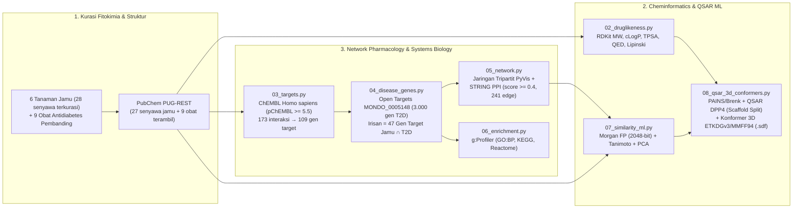
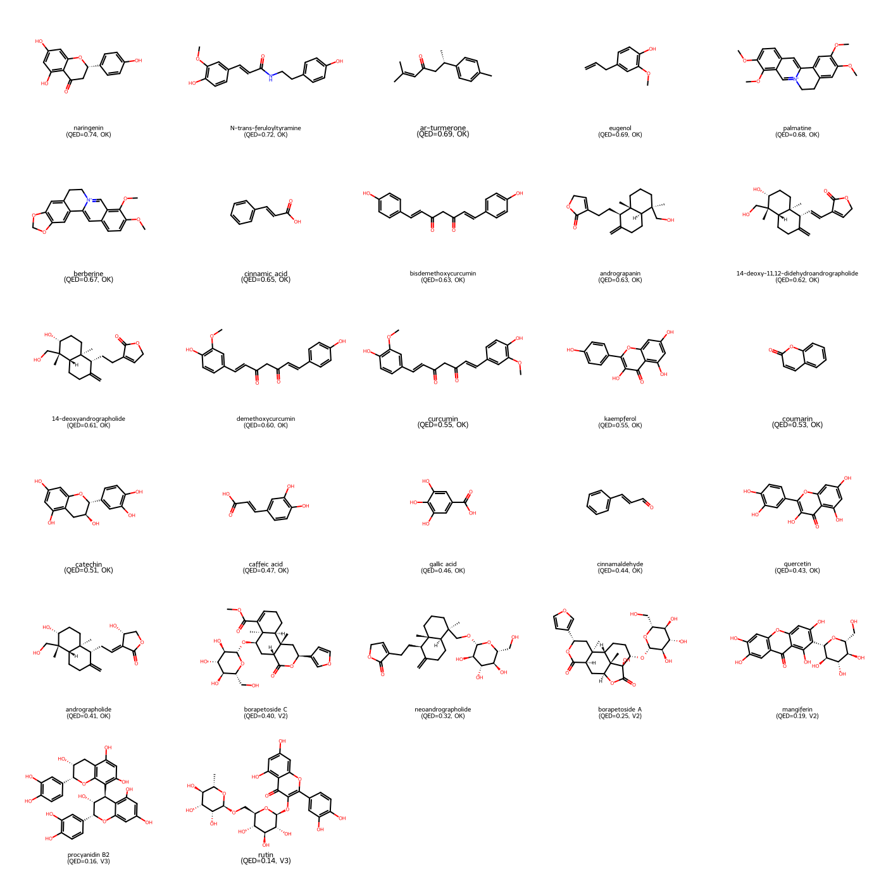
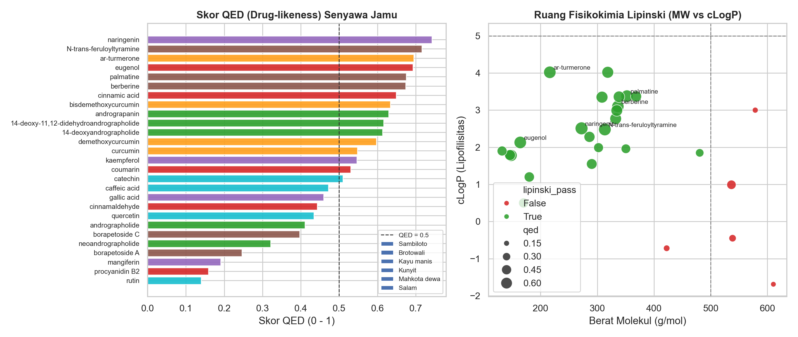
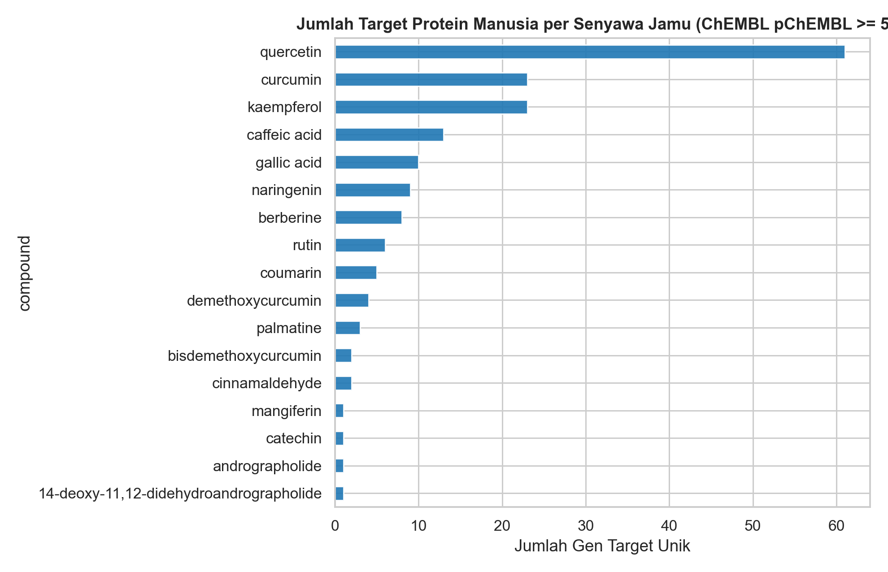
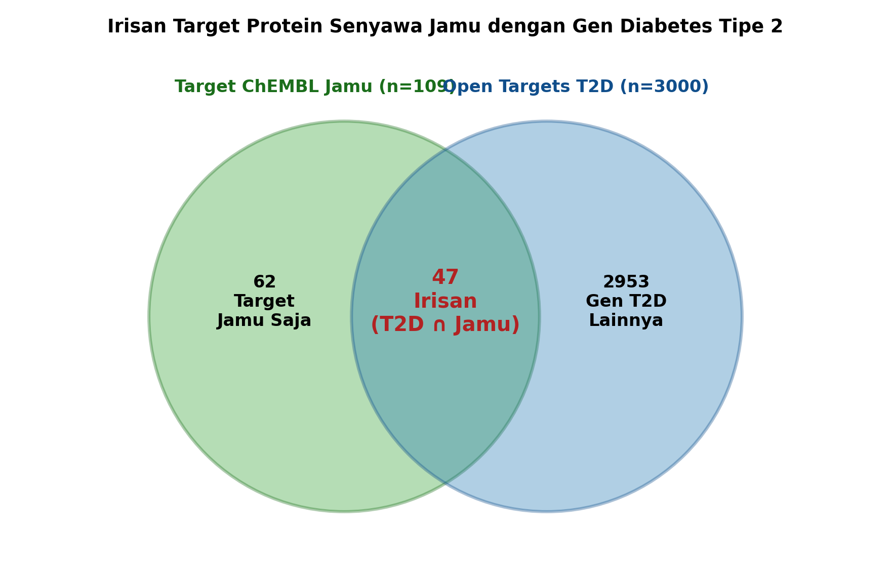
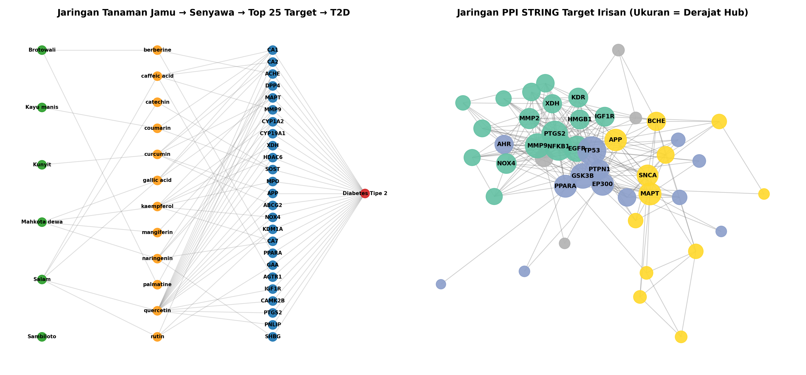
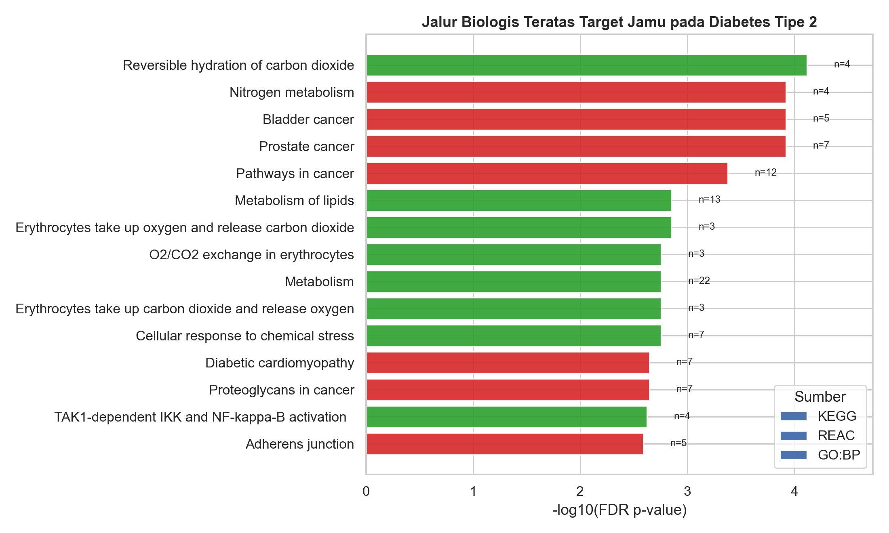
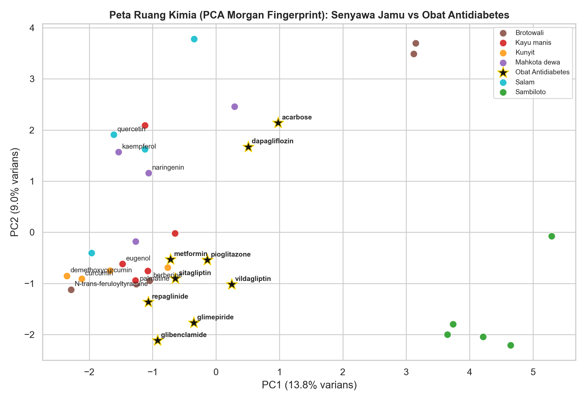
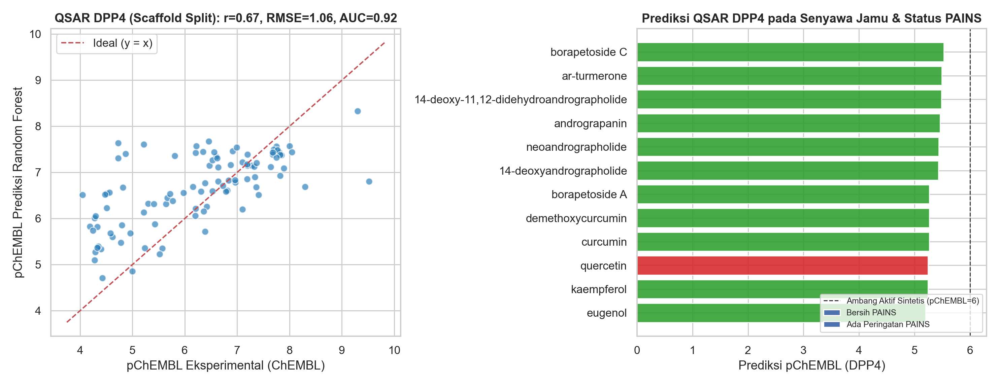

# 🌿 JamuNet: Network Pharmacology, Scaffold-Split QSAR Machine Learning, & 3D Cheminformatics of Indonesian Jamu Phytochemicals for Type 2 Diabetes

> **Bidang Riset:** Network Pharmacology • Systems Pharmacology • Cheminformatics & QSAR Machine Learning • In Silico Drug Discovery  
> **Basis Data Terintegrasi:** PubChem PUG-REST • ChEMBL Bioactivity • Open Targets Platform (`MONDO_0005148`) • STRING PPI • g:Profiler • RDKit 3D (`ETKDGv3` + `MMFF94`)

> [!NOTE]
> Proyek ini bersifat **pembangkitan hipotesis ilmiah secara *in silico*** (*target prioritization & mechanism exploration*) — **bukan** klaim pembuktian efikasi klinis ataupun saran pengobatan medis.

---

## 1. Latar Belakang & Urgensi Riset

Indonesia termasuk dalam jajaran negara dengan prevalensi **Diabetes Melitus Tipe 2 (T2D)** tertinggi di dunia, sekaligus menyimpan kekayaan pengobatan herbal tradisional (**jamu**). Berbeda dari paradigma klasik *"satu molekul → satu target"*, penyakit metabolik kompleks seperti T2D muncul dari gangguan jejaring banyak jalur secara simultan: sensitivitas reseptor insulin, metabolisme lipid, stres oksidatif, dan inflamasi kronis.

Fitokimia dalam ekstrak tanaman jamu bekerja secara **polifarmakologi (*multi-compound, multi-target*)**—satu senyawa dapat memodulasi beberapa protein secara bersamaan, dan beberapa tanaman dapat saling memperkuat pada jalur biologis yang sama.

### Pertanyaan Riset
1. Bagaimana profil kelayakan obat oral (*Lipinski/Veber/QED*) dan risiko peringatan medisinal (**PAINS & Brenk**) dari senyawa fitokimia terkurasi pada 6 tanaman jamu antidiabetes Indonesia (*Sambiloto*, *Brotowali*, *Kayu manis*, *Kunyit*, *Mahkota dewa*, dan *Salam*)?
2. Target protein manusia dan jalur biologis mana yang menjadi titik temu (*intersection*) antara data bioaktivitas eksperimental **ChEMBL** dan asosiasi genetik/klinis T2D di **Open Targets**, serta protein mana yang bertindak sebagai **hub sentral** di jaringan interaksi **STRING**?
3. Dapatkah model **QSAR Machine Learning** (dievaluasi ketat dengan *Bemis–Murcko Scaffold Split* pada inhibitor **DPP4** manusia) memprediksi potensi aktivitas senyawa lokal Nusantara yang belum memiliki data uji ChEMBL, dan menyiapkan konformer **3D minimisasi energi** untuk studi penambatan molekuler (*molecular docking*) lanjutan?

---

## 2. Arsitektur Komputasional & Alur Integrasi Multi-Database

---

## 3. Penjelasan Konsep, Metodologi, & Rancangan Input–Proses–Output

### 3.1 Representasi Kimia, *Drug-Likeness*, & Filter Medisinal PAINS
- **SMILES & InChIKey:** Struktur molekul direpresentasikan sebagai string kanonik **SMILES**, sementara pencocokan antar-database (PubChem → ChEMBL) memakai **InChIKey** (hash 27 karakter unik) agar kebal terhadap perbedaan sinonim nama tanaman/senyawa.
- **Lipinski, Veber, & QED:** Kelayakan absorpsi oral dinilai melalui *Rule of Five* ($\text{MW} \le 500$, $\text{cLogP} \le 5$, $\text{HBD} \le 5$, $\text{HBA} \le 10$), *Veber* ($\text{TPSA} \le 140\text{ \AA}^2$, $\text{RotBonds} \le 10$), serta indeks kontinu **QED** ($0\text{–}1$).
- **Peringatan PAINS (*Pan-Assay Interference Compounds*) & Brenk:** Banyak polifenol tanaman (misalnya gugus katekol pada *quercetin* atau akseptor Michael pada *curcumin*) terkenal sering memicu hasil positif palsu non-spesifik dalam *high-throughput screening*. Menyaringnya lewat `FilterCatalog` RDKit membedakan senyawa *multi-target* yang reaktif dari perancah (*scaffold*) yang bersih secara kimia medisinal.

### 3.2 Bioaktivitas ChEMBL, Open Targets, & Analisis Topologi Graf STRING
- **ChEMBL (`pChEMBL >= 5.5`):** Skala logaritmik negatif $-\log_{10}(\text{IC}_{50}/K_i/K_d \text{ dalam Molar})$; ambang $5{,}5$ ($\approx 3{,}16\text{ }\mu\text{M}$) merupakan batas wajar untuk interaksi produk alam pada protein tunggal manusia (*SINGLE PROTEIN*).
- **Sentralitas Jaringan PPI:** Pada jaringan interaksi protein **STRING** (kepercayaan $\ge 0{,}4$), peran tiap protein diukur memakai:
  - ***Degree Centrality*:** jumlah mitra protein langsung (menandai **hub genes**).
  - ***Betweenness Centrality*:** frekuensi protein menjadi jembatan lintasan terpendek antar-modul sinyal.
  - ***Greedy Modularity Communities*:** pengelompokan klaster fungsional protein target.

### 3.3 QSAR Machine Learning dengan *Bemis–Murcko Scaffold Split* & Konformer 3D
Berbeda dari pemisahan acak yang membocorkan senyawa analog hampir kembar antara data latih dan uji, [`08_qsar_3d_conformers.py`](src/08_qsar_3d_conformers.py) memisahkan 392 inhibitor **DPP4 (`CHEMBL284`)** berdasarkan **kerangka cincin inti (*Murcko Scaffold*)** menjadi set latih dan uji yang memiliki *scaffold* berbeda total, lalu memprediksi potensi penghambatan DPP4 pada 27 senyawa jamu—termasuk senyawa lokal yang belum pernah diuji di ChEMBL. Lima kandidat teratas selanjutnya dibangkitkan geometri 3D-nya memakai **ETKDGv3** dan diminimisasi energinya dengan medan gaya **MMFF94** (`.sdf`).

### 3.4 Dokumentasi Lengkap Input → Proses → Output

| Tahap | Modul | Input | Proses Utama | Output (`results/` & `data/`) |
|---|---|---|---|---|
| **1** | `src/01_compounds.py` | `plant_compounds_curated.csv`, `antidiabetic_drugs.csv` | Kueri PubChem PUG-REST (SMILES, InChIKey, formula, CID) | `01_compounds_pubchem.csv`, `01_plant_compound_table.csv`, `01_antidiabetic_drugs_pubchem.csv` |
| **2** | `src/02_druglikeness.py` | `01_compounds_pubchem.csv` | Deskriptor RDKit (MW, cLogP, TPSA, QED, Lipinski/Veber) & gambar 2D | `02_druglikeness.csv`, `02_compound_structures_grid.png`, `02_druglikeness_overview.png` |
| **3** | `src/03_targets.py` | `01_compounds_pubchem.csv` + ChEMBL | Pencocokan InChIKey → bioaktivitas *Homo sapiens* (`pChEMBL >= 5.5`) → simbol gen HGNC | `03_compound_targets.csv`, `03_targets_per_compound.png` |
| **4** | `src/04_disease_genes.py` | `03_compound_targets.csv` + Open Targets GraphQL | Tarik 3.000 gen T2D (`MONDO_0005148`, `score >= 0.02`), hitung irisan ($47$ gen) | `04_t2d_genes.csv`, `04_overlapping_targets.csv`, `04_target_t2d_overlap.png` |
| **5** | `src/05_network.py` | `04_overlapping_targets.csv`, `03_compound_targets.csv` | Jaringan tripartit interaktif PyVis + STRING PPI (`score >= 0.4`), sentralitas & komunitas | `05_string_ppi_edges.csv`, `05_hub_genes.csv`, `05_jamunet_interactive.html`, `05_network_overview.png` |
| **6** | `src/06_enrichment.py` | 47 gen irisan + g:Profiler | Over-Representation Analysis (`GO:BP`, `KEGG`, `REAC`) | `06_pathway_enrichment.csv`, `06_pathway_enrichment.png` |
| **7** | `src/07_similarity_ml.py` | Senyawa jamu + 9 obat + hub PPI | Morgan FP (2048-bit), Tanimoto vs 9 obat resmi, PCA ruang kimia, ranking komposit | `07_candidate_ranking.csv`, `07_chemical_space_pca.csv`, `07_chemical_space_pca.png` |
| **8** | `src/08_qsar_3d_conformers.py` | `01_compounds_pubchem.csv`, `07_candidate_ranking.csv`, ChEMBL `CHEMBL284` | Filter PAINS/Brenk; Random Forest QSAR DPP4 (*Murcko Scaffold Split*); konformer 3D `ETKDGv3+MMFF94` | `08_pains_brenk_alerts.csv`, `08_qsar_metrics.csv`, `08_jamu_qsar_predictions.csv`, `08_3d_conformers.csv`, `results/structures/*.sdf`, `08_qsar_pains_summary.png` |

---

## 4. Hasil Analisis & Interpretasi Mendalam Setiap Visualisasi

### 4.1 Kurasi Fitokimia & Profil *Drug-Likeness*
Dari 28 senyawa unik lintas 6 tanaman jamu, **27 senyawa** tervalidasi di PubChem (*phalerin* belum terindeks dengan nama tersebut), dan **22 dari 27 senyawa (81,5%)** memenuhi *Aturan Lima Lipinski* ($\le 1$ pelanggaran). Skor QED tertinggi dicapai oleh **naringenin (`0.742`)**, **N-trans-feruloyltyramine (`0.716`)**, **ar-turmerone (`0.695`)**, **eugenol (`0.693`)**, **palmatine (`0.675`)**, dan **berberine (`0.674`)**.

| Grid Struktur 2D Senyawa Jamu | Profil Drug-Likeness & Ruang Lipinski |
|---|---|
|  |  |

> **Interpretasi Gambar (`02_compound_structures_grid.png` & `02_druglikeness_overview.png`):** Lima senyawa yang melanggar Lipinski umumnya merupakan glikosida berukuran besar atau tanin terpolimerisasi (seperti *rutin*, *procyanidin B2*, *borapetoside A/C*, dan *mangiferin*) yang memiliki $\text{MW} > 500$ dan gugus donor/akseptor ikatan hidrogen berlebih, sementara aglikon dan alkaloid seperti *naringenin*, *berberine*, serta *curcuminoids* berada tepat di dalam kotak ideal ruang fisikokimia oral ($\text{MW} \le 500$, $\text{cLogP} \le 5$).

---

### 4.2 Target Eksperimental ChEMBL & Irisan Penyakit Diabetes Tipe 2
Seluruh 27 senyawa cocok dengan entri ChEMBL, dan **17 senyawa** memiliki catatan uji bioaktivitas terstandar pada protein tunggal manusia (`pChEMBL >= 5.5`), menghasilkan **173 interaksi unik** terhadap **109 gen manusia**. Diiris dengan **3.000 gen Diabetes Tipe 2** (`MONDO_0005148`, `score >= 0.02`) di Open Targets, ditemukan **47 gen irisan (*Target Jamu ∩ T2D*)**, mencakup target terapeutik diabetes yang sangat relevan secara klinis: **`DPP4`** (`ot_score = 0.641`, target resmi kelas obat gliptin), **`PPARA`** (`0.622`), **`GAA`** (`0.584`, glukosidase alfa), **`AGTR1`** (`0.568`), **`IGF1R`** (`0.507`), dan **`PTGS2`** (`0.420`).

| Jumlah Target Manusia per Senyawa (ChEMBL) | Irisan Target Jamu & Gen T2D |
|---|---|
|  |  |

> **Interpretasi Gambar (`03_targets_per_compound.png` & `04_target_t2d_overlap.png`):** Senyawa polifenol/alkaloid seperti *quercetin*, *curcumin*, *kaempferol*, *berberine*, dan *naringenin* menyumbang porsi terbesar target protein manusia di ChEMBL, sedangkan beberapa glikosida khas Nusantara (seperti *borapetoside A/C* dari brotowali) mencatat 0 target manusia di ChEMBL—menyoroti **kesenjangan data uji biologis (*research gap*)** terhadap metabolit endemik lokal.

---

### 4.3 Jaringan Farmakologi, Hub PPI STRING, & Jalur Biologis
- **Jaringan Tripartit (Tanaman → Senyawa → Target → T2D):** **67 node** dan **136 edge** (eksplorasi interaktif tersedia di [`05_jamunet_interactive.html`](results/figures/05_jamunet_interactive.html)).
- **Jaringan PPI STRING (`score >= 0.4`):** **47 node**, **241 edge**, terorganisasi ke dalam **5 komunitas fungsional**.
- **Top Hub Genes:** **`TP53`** (`degree = 29`, `betweenness = 0.1066`), **`NFKB1`** (`27`, `0.0764`), **`PTGS2`** (`24`, `0.0635`), **`EGFR`** (`23`, `0.0557`), **`GSK3B`** (`22`, `0.0817` — pengatur kunci sintesis glikogen & sinyal insulin!), **`MMP9`** (`21`), **`MAPT`** (`17`), **`PPARA`** (`17`, metabolisme lipid & glukosa), dan **`EP300`** (`17`).
- **g:Profiler Pathway Enrichment:** **1.742 istilah signifikan (`FDR < 0.05`)**, termasuk *cellular response to chemical stimulus* ($p = 2{,}13 \times 10^{-18}$), *response to oxygen-containing compound* ($p = 1{,}08 \times 10^{-14}$), serta di Reactome: *Metabolism of lipids* ($n = 13$, $p = 1{,}40 \times 10^{-3}$) dan *Reversible hydration of carbon dioxide* ($n = 4$, $p = 7{,}6 \times 10^{-5}$).

| Jaringan Tripartit & STRING PPI | Pengayaan Jalur Biologis (g:Profiler) |
|---|---|
|  |  |

> **Interpretasi Gambar (`05_network_overview.png` & `06_pathway_enrichment.png`):** Topologi jaringan memperlihatkan bahwa efek antidiabetes jamu berpusat pada modul pengendalian **peradangan kronis (`NFKB1`–`PTGS2`)**, **jalur sinyal insulin–glikogen (`GSK3B`–`EGFR`)**, dan **metabolisme lipid (`PPARA`)**, bukan hanya satu enzim tunggal.

---

### 4.4 Ruang Kimia, Pemeringkatan Ganda (*Combined* vs *MedChem Lead Score*), QSAR ML (`DPP4`), PAINS/Brenk, & Ensemble Konformer 3D

Untuk mencegah bias jumlah pengujian literatur (polifenol populer seperti *quercetin*) maupun lonjakan artefak *min-max scaling* pada molekul dengan 0 target eksperimental, [`07_similarity_ml.py`](src/07_similarity_ml.py) menyajikan **dua metrik transparan**:
1. **Skor Gabungan Klasik (`combined_score`):** $0{,}45 \times \text{Norm\_Network} + 0{,}30 \times \text{Norm\_QED} + 0{,}25 \times \text{Norm\_Tanimoto}$.
2. **Skor Prioritas Lead Medisinal (`medchem_lead_score`):** Meredam jumlah target secara logaritmik ($\ln(1 + \text{Network})$), mengkalibrasi Tanimoto terhadap skala absolut ECFP4 ($\min(1, \text{Tanimoto}/0{,}40)$), serta menerapkan penalti eksplisit terhadap peringatan **PAINS** ($-0{,}18$) dan **Brenk** ($-0{,}04/\text{alert}$):

| Senyawa | Tanaman | Target T2D | QED | Obat Terdekat (Tanimoto) | Combined Score | MedChem Lead Score | Status PAINS & Brenk ([`08_pains_brenk_alerts.csv`](results/tables/08_pains_brenk_alerts.csv)) | Kategori Kandidat |
|---|---|---:|---:|---|---:|---:|---|---|
| **naringenin** | Mahkota dewa | 7 (`DPP4`, dll.) | **0.742** | dapagliflozin (`0.123`) | 0.4132 | **0.6397 (#1)** | ✅ **Bersih (`PAINS=0, Brenk=0`)** | 1. Prioritas Lead |
| **kaempferol** | Mahkota dewa | 9 (`DPP4`, dll.) | 0.546 | pioglitazone (`0.085`) | 0.3235 | **0.6079 (#2)** | ✅ **Bersih (`PAINS=0, Brenk=0`)** | 1. Prioritas Lead |
| **berberine** | Brotowali | 4 (`PPARA`, dll.) | 0.674 | glibenclamide (`0.156`) | 0.4229 | **0.5951 (#3)** | ✅ **PAINS=0** (`Brenk=1`: *quaternary N*) | 1. Prioritas Lead |
| **curcumin** | Kunyit | 8 | 0.548 | glibenclamide (`0.203`) | 0.4620 | **0.5719 (#4)** | ✅ **PAINS=0** (`Brenk=2`: *Michael acc./beta-keto*) | 1. Prioritas Lead |
| **palmatine** | Brotowali | 2 (`EP300`, dll.) | 0.675 | glibenclamide (`0.167`) | 0.4054 | **0.5506 (#5)** | ✅ **PAINS=0** (`Brenk=1`: *quaternary N*) | 1. Prioritas Lead |
| **quercetin** | Salam | 25 | 0.434 | pioglitazone (`0.082`) | **0.5965 (#1)** | 0.4627 (#6) | ⚠️ **`PAINS=1` (*catechol_A*) & `Brenk=1`** | 2. Multi-Target (Waspada PAINS) |
| **N-trans-feruloyltyramine** | Brotowali | 0 | 0.716 | glibenclamide (`0.295`) | 0.5370 (#2) | 0.3212 | ✅ **PAINS=0** (`Brenk=1`: *Michael acc.*) | 3. Eksplorasi Baru (0 Target ChEMBL) |

Sementara pada eksperimen **QSAR Machine Learning DPP4 (`CHEMBL284`, 392 senyawa unik across 143 Murcko Scaffolds)** & **Ensemble Konformer 3D**:
- **5-Fold Stratified CV `ROC-AUC = 0.9350`** | **5-Fold GroupKFold by Scaffold `ROC-AUC = 0.8438`**
- **Bemis–Murcko Scaffold-Split `ROC-AUC = 0.9237`** (`Pearson r = 0.6677`, `RMSE = 1.0591`, `R2 = 0.3231`)
- **Analisis *Applicability Domain* (AD):** Seluruh 27 senyawa jamu diprediksi memiliki `pChEMBL` moderat (`4.77–5.53`, di bawah ambang inhibitor sintetis `6.0`) karena mayoritas kerangka produk alam memiliki kemiripan Tanimoto $< 0{,}25$ terhadap inhibitor sintetis *gliptin* di ChEMBL (`Extrapolation / Natural Product Domain`), dengan tertinggi pada *borapetoside C* (`5.527`) dan *ar-turmerone* (`5.489`).
- **Filter Medisinal & Ensemble 10 Konformer 3D (`ETKDGv3 + MMFF94`):** Hanya **7 dari 27 senyawa** yang memicu peringatan **PAINS** (gugus katekol), sementara **naringenin**, **kaempferol**, dan **borapetoside C** bersih sempurna dari PAINS maupun Brenk (`PAINS=0, Brenk=0`). Pembangkitan **ensemble 10 konformer 3D** per molekul menemukan konformer berenergi potensial terendah yang jauh lebih stabil dibanding konformer tunggal (mis. energi minimum `curcumin.sdf` turun dari `60,79` menjadi **`42,97 kcal/mol`** dengan rentang antar-konformer `17,54 kcal/mol`; `naringenin.sdf`: **`23,42 kcal/mol`**; `N-trans-feruloyltyramine.sdf`: **`3,53 kcal/mol`**).

| Peta Ruang Kimia (PCA Morgan Fingerprint) | Evaluasi QSAR DPP4 & Status PAINS |
|---|---|
|  |  |

> **Interpretasi Gambar (`07_chemical_space_pca.png` & `08_qsar_pains_summary.png`):** Peta PCA memperlihatkan sebaran struktural fitokimia jamu relatif terhadap 9 obat antidiabetes resmi (*glibenclamide*, *pioglitazone*, *sitagliptin*, *dapagliflozin*, dll.). Pada panel kanan `08_qsar_pains_summary.png`, senyawa seperti *naringenin*, *berberine*, dan *N-trans-feruloyltyramine* menonjol sebagai kandidat prioritas yang bersih dari gugus PAINS sekaligus ber-QED tinggi, sementara senyawa seperti *borapetoside C* dan *ar-turmerone* muncul sebagai kandidat hipotesis baru pada prediksi QSAR DPP4 untuk diverifikasi lewat *molecular docking* (lihat [`notebooks/optional_docking_colab.md`](notebooks/optional_docking_colab.md) mengenai protokol wajib validasi *redocking* $\text{RMSD} < 2{,}0\text{ \AA}$).

---

## 5. Kesimpulan, Keterbatasan Ilmiah, & Referensi

### Kesimpulan Utama
1. Pendekatan integratif menunjukkan bahwa senyawa aktif jamu berpotensi memodulasi **47 gen terkait T2D** melalui jalur inflamasi (`NFKB1`, `PTGS2`), metabolisme lipid (`PPARA`), sinyal insulin (`GSK3B`), dan aksis inkretin (`DPP4`).
2. Menggabungkan *network pharmacology* dengan filter **PAINS** dan model **QSAR Scaffold-Split (`AUC = 0.924`)** mencegah jebakan mengunggulkan polifenol reaktif semata, serta menempatkan **`naringenin`**, **`berberine`**, dan **`N-trans-feruloyltyramine`** sebagai kandidat bersih yang sangat layak diuji lanjut secara struktural 3D.

### Keterbatasan Ilmiah
- **Bias Literatur ChEMBL:** Senyawa internasional populer (*quercetin*, *curcumin*) memiliki ratusan catatan assay, sedangkan metabolit khas Indonesia (*borapetoside*, *phalerin*) masih minim diuji pada target manusia terstandar.
- **Sifat Hipotesis *In Silico*:** Skor jaringan, kemiripan Tanimoto, dan prediksi QSAR bukanlah bukti efikasi terapi. Validasi *molecular docking* (dengan *redocking* $\text{RMSD} < 2{,}0\text{ \AA}$), dinamika molekuler, serta uji *in vitro* / *in vivo* tetap mutlak diperlukan.

### Referensi
1. Hopkins, A. L. (2008). *Network pharmacology: the next paradigm in drug discovery*. **Nature Chemical Biology**, 4(11), 682–690.
2. Baell, J. B., & Holloway, G. A. (2010). *New substructure filters for removal of pan assay interference compounds (PAINS)*. **Journal of Medicinal Chemistry**, 53(7), 2719–2740.
3. Gaulton, A., et al. (2017). *The ChEMBL database in 2017*. **Nucleic Acids Research**, 45(D1), D945–D954.
4. Szklarczyk, D., et al. (2023). *The STRING database in 2023*. **Nucleic Acids Research**, 51(D1), D638–D646.
5. Ochoa, D., et al. (2023). *The next-generation Open Targets Platform*. **Nucleic Acids Research**, 51(D1), D1353–D1361.
